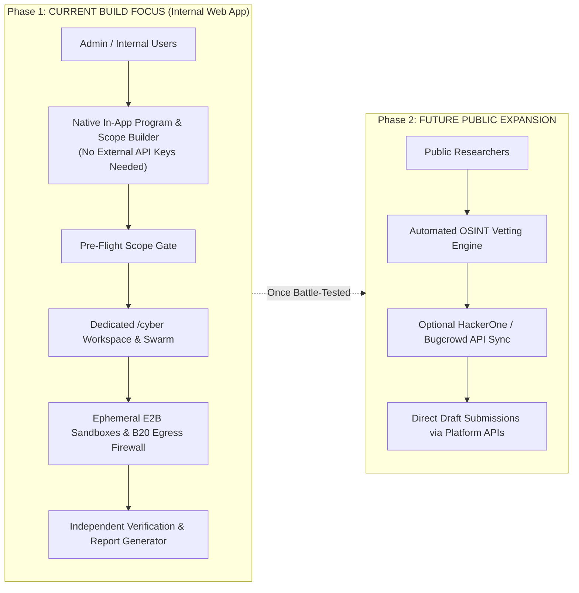
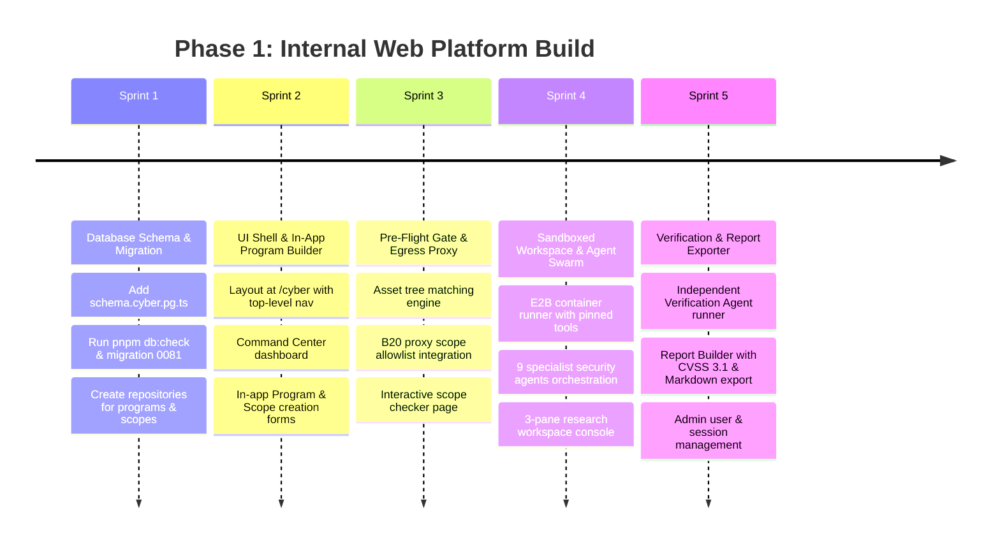

# Void Cyber — Canonical Documentation & Master Specification

> **Official Strategic Directive (Two-Phase Execution)**:
> 1. **Phase 1 (CURRENT BUILD FOCUS — Internal Web Platform)**: Focus entirely on engineering the full-stack **Void Cyber Web Platform** inside `apps/web`. Access is granted directly to **internal users, team members, and admins**. Programs, scopes, targets, and testing policies are managed through a native **In-App Program & Scope Builder** with **zero external API dependencies** (no HackerOne or Bugcrowd API keys needed). All core features—the dedicated `/cyber` UI panel, 9 specialist agents, sandboxed tool execution, B20 egress proxy firewall, evidence vault, finding verification, and professional report export—will be fully functional end-to-end.
> 2. **Phase 2 (FUTURE PUBLIC EXPANSION — Platform Connectors & Public OSINT)**: Once the internal web platform is battle-tested, we will evaluate and integrate the official **HackerOne and Bugcrowd API connectors** and launch the self-service **Automated OSINT Background Vetting Engine** for public researcher onboarding.

---

## Table of Contents
1. [Platform Vision & Phased Strategy](#1-platform-vision--phased-strategy)
2. [Complete Feature Inventory & Phase Tagging](#2-complete-feature-inventory--phase-tagging)
3. [Internal User Access & Admin Governance (Phase 1)](#3-internal-user-access--admin-governance-phase-1)
4. [Native In-App Program & Scope Management (Phase 1)](#4-native-in-app-program--scope-management-phase-1)
5. [Dedicated Cyber Panel (`/cyber`) UI/UX Architecture](#5-dedicated-cyber-panel-cyber-uiux-architecture)
6. [Specialist Agent Swarm & Tool Registry](#6-specialist-agent-swarm--tool-registry)
7. [Pre-Flight Scope Gate & Deterministic Egress Firewall](#7-pre-flight-scope-gate--deterministic-egress-firewall)
8. [Finding Verification & Report Builder](#8-finding-verification--report-builder)
9. [Future Public Expansion: Automated OSINT & Platform APIs (Phase 2)](#9-future-public-expansion-automated-osint--platform-apis-phase-2)
10. [Database Schema (PostgreSQL / Drizzle ORM)](#10-database-schema-postgresql--drizzle-orm)
11. [API Route Contracts](#11-api-route-contracts)
12. [Step-by-Step Implementation Plan](#12-step-by-step-implementation-plan)
13. [WHAT TO DO (Mandatory Standards & Best Practices)](#13-what-to-do-mandatory-standards--best-practices)
14. [WHAT NOT TO DO (Hard Prohibitions & Anti-Patterns)](#14-what-not-to-do-hard-prohibitions--anti-patterns)

---

## 1. Platform Vision & Phased Strategy

### 1.1 The Two-Phase Product Strategy



### 1.2 Self-Reliant Reasoning Engine (No Daybreak or CVP)
Void Cyber operates with complete independence from closed third-party cyber access gatekeepers (OpenAI Daybreak, Anthropic CVP):
- Standard high-reasoning foundation models (Claude 3.7 Sonnet, Gemini 2.5 Flash/Pro, GPT-4o, DeepSeek-V3, and open-weights models like Qwen 2.5 Coder / Llama 3.3) are coupled with:
  1. Proprietary security system instructions and task decomposition playbooks.
  2. Sandboxed tool execution environments with strictly validated parameters.
  3. Deterministic Layer 4/7 network egress boundaries that enforce scope physically.

---

## 2. Complete Feature Inventory & Phase Tagging

| Module | Feature Name | Phase | Description |
| :--- | :--- | :--- | :--- |
| **Access Control** | **Internal User & Admin Governance** | **Phase 1 (Now)** | Admin-controlled user invitations, role-based access control, tier assignments, and session auditing. |
| **Scope & Policy** | **Native In-App Program Builder** | **Phase 1 (Now)** | Create custom target programs, define asset scopes (domains, CIDRs, mobile apps), and set testing rules without external APIs. |
| **Scope & Policy** | **Asset Tree Normalizer** | **Phase 1 (Now)** | Hierarchical indexing of wildcard domains (`*.target.com`), subnets, and paths for deterministic matching. |
| **Scope & Policy** | **Pre-Flight Task Gate** | **Phase 1 (Now)** | Real-time validation of intended tasks against in-app program scope (`Allowed`, `Conditional`, `Disallowed`). |
| **Execution** | **Ephemeral E2B Sandboxes** | **Phase 1 (Now)** | Isolated micro-VMs spun up per session; tools run without touching the host app server. |
| **Execution** | **B20 Egress Proxy Scope Firewall** | **Phase 1 (Now)** | Layer 4 & Layer 7 outbound proxy enforcing target IP allowlists, DNS interception, and anti-SSRF drops. |
| **Execution** | **Curated Tool Registry** | **Phase 1 (Now)** | Pinned, vetted versions of `nuclei` (safe template catalog), `httpx`, `semgrep`, `ghidra` (headless), and `owasp-zap`. |
| **Agent Swarm** | **9 Specialist Subagents** | **Phase 1 (Now)** | Recon, Web Security, API Security, Cloud Security, Code Audit (SAST), Reverse Engineering, AI Security, Verification, Report. |
| **Verification** | **Independent Verification Agent** | **Phase 1 (Now)** | Automated reproduction engine running PoCs in clean sandbox contexts to eliminate false positives. |
| **Evidence** | **Tamper-Evident Evidence Vault** | **Phase 1 (Now)** | Hash-chained storage for raw HTTP request/response traces, screenshots, and PoC scripts. |
| **Reporting** | **Structured Report Generator** | **Phase 1 (Now)** | Formats findings to standard vulnerability specifications with CVSS 3.1 vectors, CWE mappings, and Markdown/PDF export. |
| **Reporting** | **Pre-Submission Quality Auditor** | **Phase 1 (Now)** | Automated scoring ($0 - 100$) checking for missing reproduction steps, exaggerated claims, or leaked credentials. |
| **Onboarding** | **Automated OSINT Vetting Engine** | Phase 2 (Future) | Autonomous crawler researching public applicant profiles across HackerOne, Bugcrowd, GitHub, and NIST NVD. |
| **Connectors** | **HackerOne / Bugcrowd API Connectors**| Phase 2 (Future) | Two-way API integration for syncing live third-party program scopes and exporting drafts directly to researcher accounts. |

---

## 3. Internal User Access & Admin Governance (Phase 1)

For the current build, access is completely internal and administered through Void Agent:

### 3.1 Access Levels
- **Admin**: Full administrative privileges. Can invite team members, create and configure target programs, adjust user tiers, inspect live sandboxes, and view all audit logs.
- **Internal Security Researcher (Tier 2/3)**: Can launch research workspaces, execute active tools against in-scope targets, verify findings, and generate reports.
- **Auditor / Read-Only (Tier 1)**: Can inspect programs, view existing findings, and review reports without active tool execution.

### 3.2 In-App Invitation & Role Assignment
1. Admin navigates to `/cyber/admin/users`.
2. Admin invites an internal user via email and assigns an initial role (`admin`, `researcher`, `auditor`).
3. User logs in, accepts the invite, and immediately gains access to the dedicated `/cyber` panel without third-party vetting delays.

---

## 4. Native In-App Program & Scope Management (Phase 1)

In Phase 1, Void Cyber does **not** require HackerOne or Bugcrowd API keys. Teams manage their target programs natively in the app:

```
+----------------------------------------------------------------------------------------------------+
|  CREATE / EDIT TARGET PROGRAM                                                         [X] Close    |
+----------------------------------------------------------------------------------------------------+
|  Program Name: [ Acme Cloud Platform Internal Audit                                             ]  |
|  Handle / Code: [ acme-cloud-audit       ]   Bounty Enabled: [x] Yes   Currency: [ USD ]           |
|                                                                                                    |
|  TARGET ASSET SCOPE (IN-SCOPE)                                                                     |
|  +-------------------------------+-------------------+-------------------------------------------+ |
|  | Asset Identifier              | Asset Type        | Testing Notes                             | |
|  +-------------------------------+-------------------+-------------------------------------------+ |
|  | *.acme.example.com            | Wildcard Domain   | Primary web app & microservices           | |
|  | 192.0.2.0/24                  | IPv4 Subnet       | Staging API cluster                       | |
|  | com.acme.android.app          | Mobile APK        | Android release build v2.4+               | |
|  +-------------------------------+-------------------+-------------------------------------------+ |
|  [ + Add Asset ]                                                                                   |
|                                                                                                    |
|  EXCLUDED ASSETS & CATEGORIES (OUT-OF-SCOPE)                                                       |
|  - Out-of-Scope Assets: admin.acme.example.com, 192.0.2.15 (Payment Gateway)                       |
|  - Excluded Categories: Denial of Service (DoS), Social Engineering, Missing DNSSEC / SPF          |
|  - Rate Limits: Max 20 requests/second per target host                                             |
|                                                                                                    |
|  [ Save Program & Index Scope Tree ]                                                               |
+----------------------------------------------------------------------------------------------------+
```

- **Asset Normalizer**: Automatically parses wildcards, subnets, and URLs into a fast in-memory and database lookup tree.
- **Zero Third-Party Dependency**: Entirely self-contained within your PostgreSQL database.

---

## 5. Dedicated Cyber Panel (`/cyber`) UI/UX Architecture

The Cyber workspace is a top-level route group inside Void Agent (`apps/web/src/app/(app)/cyber/`).

### 5.1 Route Map (Phase 1)
- `/cyber`: **Command Center Dashboard** — Target summary, active sessions, quick launcher, finding metrics.
- `/cyber/programs`: **Program Directory** — List and search internal target programs and their asset scopes.
- `/cyber/programs/new`: **In-App Program Builder** — Form for admins to create new targets and define scope trees.
- `/cyber/scope-checker`: **Interactive Pre-Flight Gate** — Instant target validator; test any URL/CIDR against policy before testing.
- `/cyber/workspace/[sessionId]`: **Research Workspace** — 3-pane live console (Swarm Chat, Live Tool Terminal, Evidence Vault).
- `/cyber/findings`: **Findings Vault** — Triage candidate vulnerabilities, view PoC scripts, track verification status.
- `/cyber/reports/[id]`: **Report Builder & Exporter** — Format findings with CVSS 3.1 calculators; export to Markdown, JSON, or PDF.
- `/cyber/admin/users`: **Admin User Governance** — Manage internal user access, assign tiers, view audit logs.

### 5.2 Workspace Layout Wireframe

```
+----------------------------------------------------------------------------------------------------+
|  VOID AGENT  |  Chat  |  Projects  |  Workflows  |  [CYBER]  |                     Admin (Tier 3)   |
+----------------------------------------------------------------------------------------------------+
|  PROGRAM: Acme Cloud Audit  |  TARGET: https://api.acme.example.com  |  SCOPE: [VERIFIED IN-SCOPE] |
+----------------------------------------------------------------------------------------------------+
|  SPECIALIST SWARM CONSOLE        |  LIVE TERMINAL & EGRESS MONITOR   |  SCOPE & EVIDENCE INSPECTOR  |
|                                  |                                   |                              |
|  [Agents: Web + API + Verifier]  |  $ httpx -l targets.txt -status   |  Target Asset:               |
|                                  |  [200] https://api.acme.example.  |  https://api.acme.example.   |
|  Web Security Agent:             |        com/v1/users               |  com/v1                      |
|  "Analyzing /v1/users endpoint.  |  [401] https://api.acme.example.  |                              |
|  Detected potential IDOR in user |        com/admin                  |  Status: [ALLOWED]           |
|  profile parameter."             |                                   |                              |
|                                  |  --- B20 Egress Proxy Stream ---  |  Egress Firewall:            |
|  API Security Agent:             |  [PASS] GET /v1/users/1042        |  - IP: 192.0.2.45 (Pinned)   |
|  "Crafted PoC request with victim|  [DROP] Blocked connection to     |  - Out-of-scope drops: 0     |
|  session token. Profile exposed."|         out-of-scope.example.com  |                              |
|                                  |                                   |  Captured Evidence:          |
|  Verification Agent:             |  Egress Status: SECURE            |  - HTTP Request/Response #1  |
|  "Re-tested in clean sandbox.    |  Active Sandbox: e2b-sbx-9982     |  - curl reproduction command |
|  Result: 100% REPRODUCIBLE."     |                                   |  - Hash: sha256:7f3b..       |
|                                  |                                   |                              |
|                                  |                                   |  [Generate Report]           |
+----------------------------------+-----------------------------------+------------------------------+
|  COMMAND: [Run API authorization audit on /v1/users/profile endpoints...]                     [Run] |
+----------------------------------------------------------------------------------------------------+
```

---

## 6. Specialist Agent Swarm & Tool Registry

### 6.1 The 9 Specialist Subagents
Instead of a single unconstrained model, tasks are delegated across 9 specialized subagents:
1. **Recon Agent**: Subdomain discovery and HTTP service probing within scope (`httpx`, `subfinder`).
2. **Web Security Agent**: OWASP Top 10 vulnerabilities (XSS, CSRF, SSRF, broken access control).
3. **API Security Agent**: REST, GraphQL, and WebSocket audits (IDOR, BOLA, rate-limit lapses).
4. **Cloud Security Agent**: Storage bucket permissions, IAM boundary audits, Cloudflare misconfigurations.
5. **Code Audit Agent**: SAST with offline `semgrep` rules and dependency vulnerability analysis.
6. **Reverse Engineering Agent**: Headless `ghidra` and `jadx` for authorized APK/binary inspection.
7. **AI Security Agent**: Model jailbreak resistance, prompt injection, and guardrail evasion on user-owned LLMs.
8. **Independent Verification Agent**: Re-executes PoCs in clean, isolated contexts to confirm automated reproducibility.
9. **Platform Report Agent**: Transforms verified findings into structured Markdown/JSON matching target platform requirements.

### 6.2 Curated Tool Registry (Ephemeral E2B Micro-VMs)
- **Nuclei**: Pinned release. Community templates are statically scanned for safety; intrusive, DoS, or data-destructive templates are removed. High-impact templates require Tier 2+ and explicit manual confirmation.
- **httpx**: Default hard rate-limits enforced (`-rl 20`, `-t 10`).
- **Semgrep**: Run fully offline within the sandbox container.
- **OWASP ZAP**: Passive scan mode enabled by default; active attacks require verified in-scope confirmation.
- **Ghidra**: Run in headless mode inside a disconnected sandbox without network interfaces.

---

## 7. Pre-Flight Scope Gate & Deterministic Egress Firewall

### 7.1 The Logical Policy Gate
Before any specialist agent or CLI tool executes against a target $T$:
1. $T$ is normalized into a canonical URL, FQDN, or IP.
2. $T$ is checked against the program's asset tree:
   - Must match an in-scope domain, wildcard, or CIDR block.
   - Must NOT match any explicit out-of-scope asset.
3. The planned testing category is evaluated against program exclusions (e.g., DoS, physical attacks, social engineering, missing SPF/DKIM).
4. If valid, the task receives an `ALLOWED` token; if intrusive, `CONDITIONAL` (requires Human-in-the-Loop review); if invalid, `DISALLOWED` with direct policy citation.

### 7.2 The Physical B20 Egress Firewall
Extending Void Agent's existing B20 proxy architecture:
- All network traffic from the sandbox container is routed through `security-egress-proxy`.
- **DNS Pinning**: Hostname resolution happens inside the proxy. Resolving out-of-scope hosts fails immediately.
- **Layer 4 & Layer 7 Scope Dropping**: Sockets attempting connection to non-allowlisted target IPs are terminated with a TCP RST.
- **Anti-SSRF Protection**: Connections to loopback (`127.0.0.0/8`), RFC1918 subnets (`10.0.0.0/8`, `172.16.0.0/12`, `192.168.0.0/16`), link-local (`169.254.0.0/16`), and cloud metadata (`169.254.169.254`) are permanently blocked at the interface level.

---

## 8. Finding Verification & Report Builder

### 8.1 Independent Verification Lifecycle
1. When an agent discovers a potential vulnerability, it is flagged as a `candidate` finding.
2. The finding payload (reproduction steps, target URL, HTTP request, payload) is dispatched to the **Independent Verification Agent**.
3. The Verification Agent spawns a fresh, clean sandbox container.
4. It executes the reproduction command and verifies whether the observed behavior matches the expected vulnerability impact.
5. If reproduced, the status upgrades to `verified`; if it fails, it is marked `unreproducible` with detailed execution logs.

### 8.2 Structured Report Formatter & Exporter
The Report Agent outputs clean, professional reports:
- Title: `[Vulnerability Type] in [Asset] leads to [Impact]`
- Weakness: CWE identifier mapping.
- Severity: CVSS v3.1 vector calculator.
- Structured Sections: Summary, Technical Details, Steps to Reproduce (numbered, curl-based), Proof of Concept, Impact, Remediation.
- **Export Formats (Phase 1)**: Formatted Markdown, structured JSON, and PDF download for internal team sharing.

---

## 9. Future Public Expansion: Automated OSINT & Platform APIs (Phase 2)

Once the Phase 1 web application is complete and thoroughly validated internally:

### 9.1 Self-Service Public Researcher Onboarding
- Public researchers can sign up and submit their portfolio (handles on HackerOne, Bugcrowd, GitHub, public CVE disclosures).
- The **Automated OSINT Vetting Engine** crawls public data sources, runs Sybil/VPN risk checks, and generates `RESEARCHER_VETTING_DOSSIER.md`.
- Computes the **VoidTrust Score** ($0 - 1000$) to automate or assist tier assignment.

### 9.2 HackerOne & Bugcrowd API Connectors
- Direct OAuth / API token connection to HackerOne and Bugcrowd.
- Automated synchronization of private and public bug bounty program scopes.
- Direct creation of draft submissions in the researcher's platform account.

---

## 10. Database Schema (PostgreSQL / Drizzle ORM)

File: `apps/web/src/lib/db/pg/schema.cyber.pg.ts`

```typescript
import { pgTable, text, timestamp, boolean, integer, jsonb, uuid, varchar, index } from "drizzle-orm/pg-core";
import { users } from "./schema.pg";

// 1. Researcher Profiles & Trust Tiers (Phase 1: Admin Governed)
export const cyberResearcherProfiles = pgTable("cyber_researcher_profiles", {
  userId: text("user_id").primaryKey().references(() => users.id, { onDelete: "cascade" }),
  accessTier: integer("access_tier").notNull().default(1), // 1: Auditor, 2: Researcher, 3: Admin
  role: varchar("role", { length: 32 }).notNull().default("researcher"), // admin, researcher, auditor
  status: varchar("status", { length: 32 }).notNull().default("active"), // active, suspended, revoked
  voidTrustScore: integer("void_trust_score").notNull().default(500),
  mfaEnforced: boolean("mfa_enforced").notNull().default(false),
  invitedByUserId: text("invited_by_user_id").references(() => users.id),
  createdAt: timestamp("created_at").defaultNow().notNull(),
  updatedAt: timestamp("updated_at").defaultNow().notNull(),
});

// 2. Native Target Programs (Phase 1: In-App Created)
export const cyberPrograms = pgTable("cyber_programs", {
  id: uuid("id").defaultRandom().primaryKey(),
  name: varchar("name", { length: 255 }).notNull(),
  programHandle: varchar("program_handle", { length: 128 }).notNull().unique(),
  description: text("description"),
  policyMarkdown: text("policy_markdown"),
  hasBounties: boolean("has_bounties").notNull().default(false),
  currency: varchar("currency", { length: 8 }).default("USD"),
  rulesMetadata: jsonb("rules_metadata").notNull().default({}), // Excluded categories, rate limits, testing windows
  createdByUserId: text("created_by_user_id").notNull().references(() => users.id),
  createdAt: timestamp("created_at").defaultNow().notNull(),
  updatedAt: timestamp("updated_at").defaultNow().notNull(),
});

// 3. In-Scope and Out-of-Scope Assets
export const cyberProgramScopes = pgTable("cyber_program_scopes", {
  id: uuid("id").defaultRandom().primaryKey(),
  programId: uuid("program_id").notNull().references(() => cyberPrograms.id, { onDelete: "cascade" }),
  assetIdentifier: text("asset_identifier").notNull(), // *.example.com, 192.168.1.0/24, com.target.app
  assetType: varchar("asset_type", { length: 32 }).notNull(), // url, domain, wildcard, cidr, mobile_app
  isInScope: boolean("is_in_scope").notNull().default(true), // true = in-scope, false = strictly prohibited
  maxSeverityAllowed: varchar("max_severity_allowed", { length: 32 }),
  instructionNotes: text("instruction_notes"),
  createdAt: timestamp("created_at").defaultNow().notNull(),
}, (table) => ({
  programAssetIdx: index("cyber_program_asset_idx").on(table.programId, table.assetIdentifier),
}));

// 4. Active Research Sessions
export const cyberSessions = pgTable("cyber_sessions", {
  id: uuid("id").defaultRandom().primaryKey(),
  userId: text("user_id").notNull().references(() => users.id, { onDelete: "cascade" }),
  programId: uuid("program_id").notNull().references(() => cyberPrograms.id),
  title: varchar("title", { length: 255 }).notNull(),
  status: varchar("status", { length: 32 }).notNull().default("active"), // active, paused, archived
  sandboxId: varchar("sandbox_id", { length: 128 }),
  sandboxProxyToken: text("sandbox_proxy_token"),
  assignedAgents: jsonb("assigned_agents").notNull().default([]),
  createdAt: timestamp("created_at").defaultNow().notNull(),
  updatedAt: timestamp("updated_at").defaultNow().notNull(),
});

// 5. Security Findings & Proof-of-Concepts
export const cyberFindings = pgTable("cyber_findings", {
  id: uuid("id").defaultRandom().primaryKey(),
  sessionId: uuid("session_id").notNull().references(() => cyberSessions.id, { onDelete: "cascade" }),
  userId: text("user_id").notNull().references(() => users.id),
  title: varchar("title", { length: 255 }).notNull(),
  cweId: varchar("cwe_id", { length: 32 }),
  cvssScore: varchar("cvss_score", { length: 16 }),
  severity: varchar("severity", { length: 32 }).notNull(), // info, low, medium, high, critical
  affectedAsset: text("affected_asset").notNull(),
  status: varchar("status", { length: 32 }).notNull().default("candidate"), // candidate, verified, reported
  reproductionSteps: text("reproduction_steps").notNull(),
  proofOfConcept: text("proof_of_concept").notNull(),
  impactDescription: text("impact_description").notNull(),
  remediationGuidance: text("remediation_guidance"),
  rawToolOutputs: jsonb("raw_tool_outputs").default({}),
  verificationLog: text("verification_log"),
  createdAt: timestamp("created_at").defaultNow().notNull(),
  updatedAt: timestamp("updated_at").defaultNow().notNull(),
});

// 6. Evidence Vault (Hash-Chained Artifacts)
export const cyberEvidenceVault = pgTable("cyber_evidence_vault", {
  id: uuid("id").defaultRandom().primaryKey(),
  findingId: uuid("finding_id").notNull().references(() => cyberFindings.id, { onDelete: "cascade" }),
  evidenceType: varchar("evidence_type", { length: 32 }).notNull(), // http_trace, screenshot, poc_script, terminal_log
  sha256Hash: varchar("sha256_hash", { length: 64 }).notNull(),
  payloadBytes: text("payload_bytes").notNull(),
  capturedAt: timestamp("captured_at").defaultNow().notNull(),
});

// 7. Structured Reports & Exports
export const cyberReports = pgTable("cyber_reports", {
  id: uuid("id").defaultRandom().primaryKey(),
  findingId: uuid("finding_id").notNull().references(() => cyberFindings.id, { onDelete: "cascade" }),
  reportFormat: varchar("report_format", { length: 32 }).notNull().default("markdown"), // markdown, json, pdf
  compiledPayload: jsonb("compiled_payload").notNull(),
  qualityScore: integer("quality_score").notNull().default(0), // 0-100
  qualityFeedback: jsonb("quality_feedback").default([]),
  exportedAt: timestamp("exported_at"),
  createdAt: timestamp("created_at").defaultNow().notNull(),
});

// 8. Behavioral Audit Events
export const cyberAuditEvents = pgTable("cyber_audit_events", {
  id: uuid("id").defaultRandom().primaryKey(),
  userId: text("user_id").notNull().references(() => users.id, { onDelete: "cascade" }),
  sessionId: uuid("session_id").references(() => cyberSessions.id),
  eventType: varchar("event_type", { length: 64 }).notNull(), // scope_check, scope_breach_prevented, tool_disallowed
  severity: varchar("severity", { length: 16 }).notNull().default("info"),
  details: jsonb("details").notNull().default({}),
  timestamp: timestamp("timestamp").defaultNow().notNull(),
});
```

---

## 11. API Route Contracts (Phase 1)

### 11.1 Native Program & Scope Management
- `GET /api/cyber/programs`: List internal programs.
- `POST /api/cyber/programs`: Create a new target program with scope assets and policy rules.
- `POST /api/cyber/programs/[id]/scopes`: Add or update in-scope and out-of-scope assets.
- `POST /api/cyber/scope/preflight`: Evaluates `{ programId, targetAsset, category }` and returns `{ status: 'allowed' | 'conditional' | 'disallowed' }`.

### 11.2 Sessions & Tool Execution
- `POST /api/cyber/sessions`: Spawns research session with E2B micro-VM and egress proxy token.
- `POST /api/cyber/sessions/[id]/dispatch`: Dispatches agent commands (`nuclei`, `httpx`, `semgrep`).

### 11.3 Findings & Reports
- `POST /api/cyber/findings/[id]/verify`: Triggers the Independent Verification Agent.
- `POST /api/cyber/reports/compile`: Generates structured report payload with CVSS calculator.
- `GET /api/cyber/reports/[id]/export`: Downloads Markdown or JSON report bundle.

---

## 12. Step-by-Step Implementation Plan (Phase 1 Build)



---

## 13. WHAT TO DO (Mandatory Standards & Best Practices)

1. **DO Focus on the Web Platform First**:
   Build the complete, polished, responsive UI inside `apps/web` with functional workflows from day one.
2. **DO Make Program Scope Self-Contained**:
   Allow admins to define targets, domains, CIDRs, and exclusion rules directly inside the app without external APIs.
3. **DO Enforce Scope Deterministically at the Network Layer**:
   Ensure all sandbox egress traffic passes through `security-egress-proxy` with Layer 4/7 target IP allowlisting.
4. **DO Require Independent Verification for Every Finding**:
   Always execute candidate PoCs in a clean, isolated micro-VM before marking them as verified.
5. **DO Protect Local Infrastructure Against SSRF**:
   Block loopback (`127.0.0.1`), RFC1918 private subnets, and cloud metadata (`169.254.169.254`) unconditionally.
6. **DO Keep Code Clean and Well-Architected**:
   Adhere to Drizzle ORM conventions, Next.js Server Components, and Radix/Tailwind styling matching Void Agent design patterns.

---

## 14. WHAT NOT TO DO (Hard Prohibitions & Anti-Patterns)

1. **DO NOT Block Internal Development on Third-Party APIs**:
   Do not wait for or depend upon HackerOne or Bugcrowd API keys to build the core platform. The app must be 100% functional internally first.
2. **DO NOT Rely on OpenAI Daybreak or Anthropic CVP**:
   Never gate features behind third-party cyber access programs. Void Cyber uses standard base models and custom tool harnesses.
3. **DO NOT Execute Security Tools on the Host App Server**:
   Never run `nuclei`, `httpx`, or target PoCs directly in the Node.js/Next.js environment. Always use E2B sandboxes.
4. **DO NOT Build Fake Mockups or Simulated Buttons**:
   Per the Hack2Skill rubric ([PROJECT_PRIORITIES.md](file:///C:/Users/Ibrahim/Desktop/Void-Agent/PROJECT_PRIORITIES.md)), ensure all buttons, forms, and workflows operate end-to-end.
5. **DO NOT Allow Arbitrary Internet Egress**:
   Never let a sandbox container connect to non-target internet destinations.
6. **DO NOT Store Unredacted Victim Data**:
   Never persist sensitive user credentials or PII discovered during research in chat history or memory.

---

*This document serves as the canonical master specification for building the Void Cyber web platform.*
