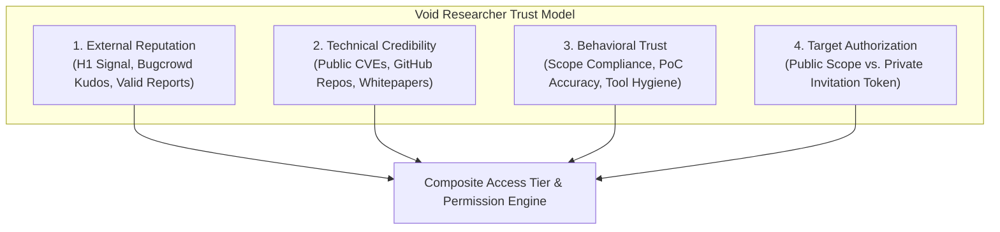
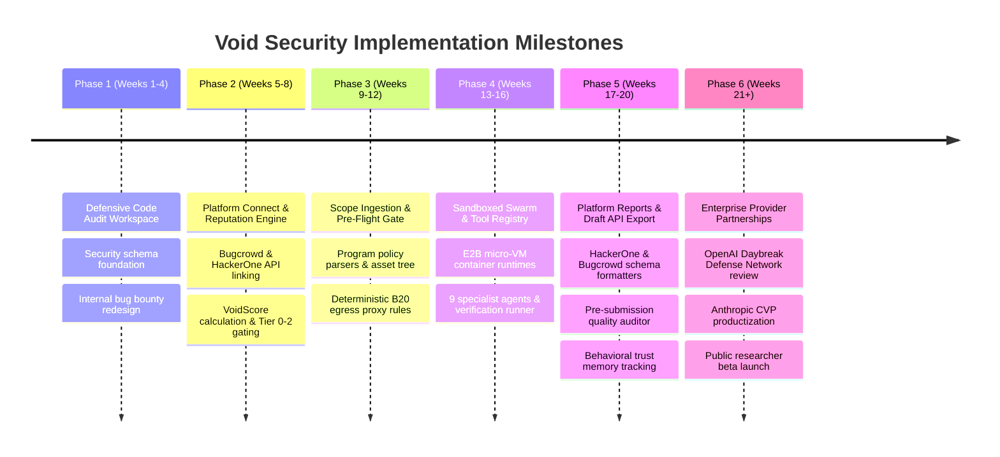

# Void Security — Master Implementation Specification & Engineering Blueprint

This document specifies the complete engineering, architectural, and operational implementation plan for **Void Security**, transforming Void Agent into an **AI-Powered Security Research and Bug Bounty Ecosystem**.

Derived from the full analysis of [`VoidCyberSecurity.md`](file:///C:/Users/Ibrahim/Desktop/Void-Agent/VoidCyberSecurity.md), this plan details how to build the platform without relying on single-provider assumptions, how to enforce target scope deterministically, and how to bridge researcher reputation to verified platform submissions.

---

## Table of Contents
1. [Executive Vision & Strategic Value](#1-executive-vision--strategic-value)
2. [Market Context & The Provider Problem](#2-market-context--the-provider-problem)
3. [The 4-Dimensional Void Researcher Trust Model](#3-the-4-dimensional-void-researcher-trust-model)
4. [End-to-End Bug Bounty Research Workflow](#4-end-to-end-bug-bounty-research-workflow)
5. [System Architecture & Component Topology](#5-system-architecture--component-topology)
6. [Database Schema (PostgreSQL / Drizzle ORM)](#6-database-schema-postgresql--drizzle-orm)
7. [API Route Specifications & Contracts](#7-api-route-specifications--contracts)
8. [Scope Ingestion & Pre-Execution Policy Gate](#8-scope-ingestion--pre-execution-policy-gate)
9. [Hardened Sandbox & Network Egress Layer](#9-hardened-sandbox--network-egress-layer)
10. [Specialist Security Agent Swarm](#10-specialist-security-agent-swarm)
11. [Platform Report Generator & Draft Submission](#11-platform-report-generator--draft-submission)
12. [AI Safety & Model Security (Jailbreak / Red-Teaming)](#12-ai-safety--model-security-jailbreak--red-teaming)
13. [UI / UX Design & Navigation](#13-ui--ux-design--navigation)
14. [Phased Implementation Roadmap](#14-phased-implementation-roadmap)
15. [Compliance, Legal & Abuse Prevention](#15-compliance-legal--abuse-prevention)

---

## 1. Executive Vision & Strategic Value

Void Security is a dedicated, restricted-access product module inside Void Agent. It transitions Void Agent from a developer-focused assistant into a **researcher-first security research ecosystem**.

### Key Value Differentiators
- **Beyond a Raw Terminal with Nuclei**: A researcher specifies an authorized target and its program scope. Void Security prepares an isolated environment, coordinates specialized agents, executes permitted checks within strict network guardrails, independently verifies potential vulnerabilities, and compiles platform-native, evidence-backed reports.
- **Transparent Researcher Eligibility**: Instead of ambiguous rejections (common in OpenAI Daybreak or Anthropic CVP), Void Security provides clear, verifiable criteria based on linked platform track records, public research, and in-platform behavioral history.
- **Execution-Layer Boundary Enforcement**: Scope rules are enforced by virtualized networks and egress proxies—not by model system prompts that can be bypassed or jailbroken.
- **Responsible Ecosystem Integration**: Integrates directly with official platform APIs (Bugcrowd Hacker API and HackerOne Hacker API) to create draft submissions without scraping or violating terms.

---

## 2. Self-Reliant Cyber Strategy: Independence from Daybreak & CVP

### Why Void Agent Builds Its Own Cyber Engine
Rather than pursuing or depending upon OpenAI Daybreak or Anthropic CVP partnerships:
1. **Full Autonomy & Predictable Access**: Third-party cyber verification programs are opaque, reject legitimate researchers without explanation, and forbid downstream product pass-through. Void Agent builds its own independent security engine and model harnesses.
2. **Autonomous Researcher Background Research (OSINT Engine)**: Rather than relying on external gatekeepers, Void Agent implements its own automated research pipeline to investigate applicants (querying HackerOne, Bugcrowd, GitHub, public CVE databases, technical disclosures, and CTF rankings).
3. **Dedicated Cyber Surface (`/cyber`)**: A complete, native product panel within Void Agent, giving ethical hackers and bug bounty researchers a dedicated Command Center, Scope Inspector, Sandboxed Workspace, and Platform Report Builder.
4. **Self-Contained Model Reasoning & Tool Harnesses**: High-reasoning base models (Claude Sonnet, Gemini Flash/Pro, GPT-4o, DeepSeek, and open-weights fine-tunes like Qwen 2.5 Coder) are wrapped in custom security instructions, sandboxed execution runtimes, and deterministic Layer 4/7 egress firewalls.

---

## 3. The 4-Dimensional Void Researcher Trust Model

Void Security evaluates researchers across four distinct, independent dimensions:



### Access Tiers
| Tier | Title | Qualification Requirements | Granted Capabilities |
| :--- | :--- | :--- | :--- |
| **Tier 0** | **Applicant** | Email verified, profile submitted, initial portfolio links | Read-only security playbooks, CVE knowledge base, report templates. No tool execution. |
| **Tier 1** | **Verified Researcher** | Identity verification (Persona/Stripe Identity) OR active linked H1/Bugcrowd account with valid submissions; MFA enabled | Defensive analysis, source code SAST, dependency auditing, passive recon, private repository review. |
| **Tier 2** | **Trusted Researcher** | High Signal/Kudos, demonstrated vulnerability disclosure history, high report acceptance rate | Active API testing, template-pinned Nuclei scanning, isolated VM sandbox execution, draft report export. |
| **Tier 3** | **Organization / Red Team** | Corporate verification, legal testing authorization, signed NDA and explicit customer authorization | Full multi-agent swarm orchestration, reverse engineering (Ghidra), elevated concurrency, custom tools. |

### Behavioral Trust Intelligence (Void Memory)
The system maintains structured, auditable Markdown records under `researcher/<userId>/` in the Void Memory subsystem:
- `PROFILE.md`: Base researcher identity and current verified tier.
- `REPUTATION.md`: External platform metrics (H1 Signal/Impact, Bugcrowd Kudos/Rank, CVE list).
- `BEHAVIOUR.md`: Observed platform compliance (adherence to scope, responsiveness to warnings, reproduction success rate).
- `POLICY_COMPLIANCE.md`: Timestamped log of scope-check successes and prevented out-of-scope actions.
- `REPORT_QUALITY.md`: Accuracy metrics, duplication indicators, and feedback on generated drafts.
- `ACCOUNT_CONNECTIONS.md`: Status of connected OAuth/API tokens.
- `TRUST_ASSESSMENT.md`: Automated, periodic synthesis of researcher trust status.

*Lifecycle Rule*: If a connected account is unlinked or its token expires, privileged access is **suspended** (not banned), preserving historical audit logs until re-authenticated.

---

## 4. End-to-End Bug Bounty Research Workflow

```mermaid
sequenceDiagram
    autonumber
    actor R as Researcher
    participant UI as Void Security UI
    participant Trust as Trust & Scope Engine
    participant Gate as Pre-Execution Task Gate
    participant Orch as Void Orchestrator
    participant Box as Sandboxed Runtime & Egress Proxy
    participant Verifier as Independent Verification Agent
    participant Reporter as Platform Report Agent
    participant Platform as Bugcrowd / HackerOne API

    R->>UI: Connect HackerOne / Bugcrowd Account
    UI->>Trust: Validate credentials & calculate VoidScore
    R->>UI: Select Program & State Research Goal
    UI->>Trust: Sync Program Scope & Exclusions
    Trust->>Gate: Evaluate Goal vs. Program Policy
    Gate-->>UI: Return Evaluation: ALLOWED / CONDITIONAL / DISALLOWED
    alt Is Allowed
        UI->>Orch: Launch Session with Specialist Agents
        Orch->>Box: Spin up E2B Micro-VM with Egress Proxy
        Box->>Box: Execute Pinned Recon & Security Tools
        Box-->>Orch: Return Raw Findings & HTTP Traces
        Orch->>Verifier: Dispatch Finding for Reproduction
        Verifier->>Box: Re-run PoC in Clean Isolated Context
        Verifier-->>Orch: Finding Verified (Reproducible)
        Orch->>Reporter: Format Platform-Specific Report
        Reporter->>UI: Present Report & Quality Score
        R->>UI: Approve Draft Export
        UI->>Platform: POST Draft via Hacker API
        Platform-->>UI: Draft Created Successfully
    else Is Disallowed
        Gate-->>UI: Block with Exact Policy Citation
    end
```

---

## 5. System Architecture & Component Topology

```
┌─────────────────────────────────────────────────────────────────────────┐
│                      Void Security Presentation Layer                   │
│   (Overview | Programs | Scope Manager | Workspace | Reports | Audit)   │
└────────────────────────────────────┬────────────────────────────────────┘
                                     │
┌────────────────────────────────────▼────────────────────────────────────┐
│                    Void Security Core Controller                        │
│   ┌───────────────────────────┐     ┌───────────────────────────────┐   │
│   │ Trust & Reputation Engine │     │ Program Scope & Policy Parser │   │
│   └─────────────┬─────────────┘     └───────────────┬───────────────┘   │
│                 │                                   │                   │
│   ┌─────────────▼───────────────────────────────────▼───────────────┐   │
│   │             Pre-Execution Task Eligibility Gate                 │   │
│   └─────────────────────────────┬───────────────────────────────────┘   │
└─────────────────────────────────┼───────────────────────────────────────┘
                                  │ (Authorized Tasks Only)
┌─────────────────────────────────▼───────────────────────────────────────┐
│                      Void Orchestrator Swarm Layer                      │
│   ┌───────────────┐ ┌───────────────┐ ┌───────────────┐ ┌───────────┐   │
│   │  Recon Agent  │ │   Web Agent   │ │   API Agent   │ │Cloud Agent│   │
│   └───────┬───────┘ └───────┬───────┘ └───────┬───────┘ └─────┬─────┘   │
│           │                 │                 │               │         │
│   ┌───────▼───────┐ ┌───────▼───────┐ ┌───────▼───────┐       │         │
│   │CodeSAST Agent │ │ Reverse Eng   │ │ AI Sec Agent  │       │         │
│   └───────┬───────┘ └───────┬───────┘ └───────┬───────┘       │         │
│           └─────────────────┼─────────────────┘               │         │
│                             ▼                                 │         │
│         ┌───────────────────────────────────────┐             │         │
│         │     Independent Verification Agent    │◄────────────┘         │
│         └───────────────────┬───────────────────┘                       │
│                             ▼                                           │
│         ┌───────────────────────────────────────┐                       │
│         │         Platform Report Agent         │                       │
│         └───────────────────────────────────────┘                       │
└─────────────────────────────────┬───────────────────────────────────────┘
                                  │
┌─────────────────────────────────▼───────────────────────────────────────┐
│                   Isolated Execution & Egress Boundary                  │
│   ┌─────────────────────────────────────────────────────────────────┐   │
│   │ Ephemeral E2B Micro-VM (Tools: Nuclei, httpx, ZAP, Semgrep)     │   │
│   └────────────────────────────────┬────────────────────────────────┘   │
│                                    ▼                                    │
│   ┌─────────────────────────────────────────────────────────────────┐   │
│   │ Security Egress Proxy (DNS Pinning, Layer 4/7 Scope Firewall)   │   │
│   └────────────────────────────────┬────────────────────────────────┘   │
└────────────────────────────────────┼────────────────────────────────────┘
                                     │ (Outbound to In-Scope Targets Only)
                                     ▼
                          [ Target Infrastructure ]
```

---

## 6. Database Schema (PostgreSQL / Drizzle ORM)

File: `apps/web/src/lib/db/pg/schema.security.pg.ts`

```typescript
import { pgTable, text, timestamp, boolean, integer, jsonb, uuid, varchar, index } from "drizzle-orm/pg-core";
import { users } from "./schema.pg";

// 1. Researcher Profile & Access Tiers
export const securityResearchers = pgTable("security_researchers", {
  userId: text("user_id").primaryKey().references(() => users.id, { onDelete: "cascade" }),
  accessTier: integer("access_tier").notNull().default(0), // 0: Applicant, 1: Verified, 2: Trusted, 3: Org
  status: varchar("status", { length: 32 }).notNull().default("pending"), // pending, active, suspended, revoked
  voidScore: integer("void_score").notNull().default(0), // 0 - 1000 aggregated score
  idVerificationProvider: varchar("id_verification_provider", { length: 64 }), // stripe_identity, persona, manual
  idVerificationReference: text("id_verification_reference"),
  idVerifiedAt: timestamp("id_verified_at"),
  mfaEnforced: boolean("mfa_enforced").notNull().default(false),
  suspensionReason: text("suspension_reason"),
  createdAt: timestamp("created_at").defaultNow().notNull(),
  updatedAt: timestamp("updated_at").defaultNow().notNull(),
});

// 2. Connected Platform Accounts
export const researcherConnectedAccounts = pgTable("researcher_connected_accounts", {
  id: uuid("id").defaultRandom().primaryKey(),
  userId: text("user_id").notNull().references(() => users.id, { onDelete: "cascade" }),
  platform: varchar("platform", { length: 32 }).notNull(), // hackerone, bugcrowd, github
  platformUsername: varchar("platform_username", { length: 128 }).notNull(),
  platformUserId: varchar("platform_user_id", { length: 128 }),
  encryptedToken: text("encrypted_token").notNull(), // AES-256-GCM via ENCRYPTION_MASTER_KEY
  tokenExpiresAt: timestamp("token_expires_at"),
  metrics: jsonb("metrics").notNull().default({}), // signal, impact, kudos, rank, accepted_reports
  verifiedFindingsCount: integer("verified_findings_count").notNull().default(0),
  lastSyncedAt: timestamp("last_synced_at").defaultNow().notNull(),
  isActive: boolean("is_active").notNull().default(true),
  createdAt: timestamp("created_at").defaultNow().notNull(),
}, (table) => ({
  userPlatformIdx: index("user_platform_idx").on(table.userId, table.platform),
}));

// 3. Bug Bounty Programs & Policy Cache
export const securityPrograms = pgTable("security_programs", {
  id: uuid("id").defaultRandom().primaryKey(),
  platform: varchar("platform", { length: 32 }).notNull(), // hackerone, bugcrowd, custom
  platformProgramHandle: varchar("platform_program_handle", { length: 128 }).notNull(),
  name: varchar("name", { length: 255 }).notNull(),
  policyUrl: text("policy_url"),
  policyMarkdown: text("policy_markdown"),
  policyVersionHash: varchar("policy_version_hash", { length: 64 }),
  hasBounties: boolean("has_bounties").notNull().default(true),
  minBountyCents: integer("min_bounty_cents"),
  maxBountyCents: integer("max_bounty_cents"),
  currency: varchar("currency", { length: 8 }).default("USD"),
  safeHarborLevel: varchar("safe_harbor_level", { length: 32 }).default("full"),
  rulesMetadata: jsonb("rules_metadata").notNull().default({}), // Excluded categories, rate limits, windows
  lastSyncedAt: timestamp("last_synced_at").defaultNow().notNull(),
  createdAt: timestamp("created_at").defaultNow().notNull(),
});

// 4. In-Scope and Out-of-Scope Assets
export const securityProgramScopes = pgTable("security_program_scopes", {
  id: uuid("id").defaultRandom().primaryKey(),
  programId: uuid("program_id").notNull().references(() => securityPrograms.id, { onDelete: "cascade" }),
  assetIdentifier: text("asset_identifier").notNull(), // *.example.com, 10.0.0.0/8, com.target.app
  assetType: varchar("asset_type", { length: 32 }).notNull(), // url, domain, wildcard, cidr, mobile_app
  isInScope: boolean("is_in_scope").notNull().default(true), // true = targetable, false = strictly off-limits
  maxSeverityAllowed: varchar("max_severity_allowed", { length: 32 }),
  instructionNotes: text("instruction_notes"),
  createdAt: timestamp("created_at").defaultNow().notNull(),
}, (table) => ({
  programAssetIdx: index("program_asset_idx").on(table.programId, table.assetIdentifier),
}));

// 5. Research Sessions
export const securityResearchSessions = pgTable("security_research_sessions", {
  id: uuid("id").defaultRandom().primaryKey(),
  userId: text("user_id").notNull().references(() => users.id, { onDelete: "cascade" }),
  programId: uuid("program_id").notNull().references(() => securityPrograms.id),
  title: varchar("title", { length: 255 }).notNull(),
  status: varchar("status", { length: 32 }).notNull().default("active"), // active, paused, archived
  sandboxId: varchar("sandbox_id", { length: 128 }),
  sandboxProxyToken: text("sandbox_proxy_token"),
  assignedAgents: jsonb("assigned_agents").notNull().default([]),
  createdAt: timestamp("created_at").defaultNow().notNull(),
  updatedAt: timestamp("updated_at").defaultNow().notNull(),
});

// 6. Security Findings & Proof-of-Concepts
export const securityFindings = pgTable("security_findings", {
  id: uuid("id").defaultRandom().primaryKey(),
  sessionId: uuid("session_id").notNull().references(() => securityResearchSessions.id, { onDelete: "cascade" }),
  userId: text("user_id").notNull().references(() => users.id),
  title: varchar("title", { length: 255 }).notNull(),
  cweId: varchar("cwe_id", { length: 32 }),
  cvssScore: varchar("cvss_score", { length: 16 }),
  severity: varchar("severity", { length: 32 }).notNull(), // info, low, medium, high, critical
  affectedAsset: text("affected_asset").notNull(),
  status: varchar("status", { length: 32 }).notNull().default("candidate"), // candidate, verified, reported
  reproductionSteps: text("reproduction_steps").notNull(),
  proofOfConcept: text("proof_of_concept").notNull(),
  impactDescription: text("impact_description").notNull(),
  remediationGuidance: text("remediation_guidance"),
  rawToolOutputs: jsonb("raw_tool_outputs").default({}),
  verificationLog: text("verification_log"),
  createdAt: timestamp("created_at").defaultNow().notNull(),
  updatedAt: timestamp("updated_at").defaultNow().notNull(),
});

// 7. Structured Reports & Draft Submissions
export const securityReports = pgTable("security_reports", {
  id: uuid("id").defaultRandom().primaryKey(),
  findingId: uuid("finding_id").notNull().references(() => securityFindings.id, { onDelete: "cascade" }),
  targetPlatform: varchar("target_platform", { length: 32 }).notNull(), // hackerone, bugcrowd, markdown
  platformPayload: jsonb("platform_payload").notNull(),
  qualityScore: integer("quality_score").notNull().default(0), // 0-100 quality score
  qualityFeedback: jsonb("quality_feedback").default([]),
  draftExportedAt: timestamp("draft_exported_at"),
  platformSubmissionId: varchar("platform_submission_id", { length: 128 }),
  createdAt: timestamp("created_at").defaultNow().notNull(),
});

// 8. Behavioral Audit Events
export const securityBehaviorEvents = pgTable("security_behavior_events", {
  id: uuid("id").defaultRandom().primaryKey(),
  userId: text("user_id").notNull().references(() => users.id, { onDelete: "cascade" }),
  sessionId: uuid("session_id").references(() => securityResearchSessions.id),
  eventType: varchar("event_type", { length: 64 }).notNull(), // scope_check, scope_breach_prevented, tool_disallowed
  severity: varchar("severity", { length: 16 }).notNull().default("info"),
  details: jsonb("details").notNull().default({}),
  timestamp: timestamp("timestamp").defaultNow().notNull(),
});
```

---

## 7. API Route Specifications & Contracts

### 7.1 Researcher Profile & Platform Linking
- `GET /api/security/researcher/profile`
  - Returns: `{ tier, voidScore, connectedAccounts: [...], mfaEnforced, status }`
- `POST /api/security/researcher/connect`
  - Body: `{ platform: 'bugcrowd' | 'hackerone', token: string }`
  - Logic: Validates token against platform API, fetches identity & statistics, encrypts token with AES-256-GCM, stores record, recalculates `voidScore`.
- `DELETE /api/security/researcher/disconnect`
  - Body: `{ platform: string }`
  - Logic: Marks account inactive, suspends Tier 2+ execution capabilities, retains audit events.

### 7.2 Program Management & Scope Ingestion
- `GET /api/security/programs`
  - Returns list of programs available to the researcher (public programs + invited private programs from connected accounts).
- `POST /api/security/programs/sync`
  - Body: `{ programId: string }`
  - Logic: Pulls fresh scope, exclusions, and markdown policy from Bugcrowd/HackerOne API; re-indexes the asset tree.

### 7.3 Pre-Flight Task Evaluation Gate
- `POST /api/security/tasks/preflight`
  - Body: `{ programId: string, targetAsset: string, category: string, method: string }`
  - Returns:
    ```json
    {
      "status": "allowed" | "conditional" | "disallowed" | "unknown",
      "isAssetInScope": true,
      "isCategoryPermitted": true,
      "policyCitations": [
        { "section": "Section 2.1: In-Scope Domains", "quote": "*.api.acme.com is eligible." }
      ],
      "requiresHITL": false,
      "restrictions": ["Do not exceed 10 req/sec"]
    }
    ```

### 7.4 Session & Tool Execution
- `POST /api/security/sessions`
  - Body: `{ programId: string, title: string }`
  - Returns: `{ sessionId, sandboxId, proxyToken, assignedAgents }`
- `POST /api/security/sessions/[id]/command`
  - Body: `{ tool: 'nuclei' | 'httpx' | 'semgrep', args: string[], target: string }`
  - Logic: Passes target through the Pre-Flight Gate; if allowed, dispatches to the sandbox with target-pinned egress credentials.

### 7.5 Findings, Verification & Report Drafting
- `POST /api/security/findings/[id]/verify`
  - Triggers the **Independent Verification Agent** in a clean container context.
- `POST /api/security/reports/generate`
  - Body: `{ findingId: string, targetPlatform: 'hackerone' | 'bugcrowd' }`
  - Compiles formatted payload and computes quality score ($0 - 100$).
- `POST /api/security/reports/[id]/export-draft`
  - Transmits draft submission to Bugcrowd (`POST /hackers/programs/{code}/submissions`) or HackerOne API.

---

## 8. Scope Ingestion & Pre-Execution Policy Gate

### 8.1 API Connectors
- **Bugcrowd Hacker API**:
  - `GET /hackers/programs`
  - `GET /hackers/programs/{code}`
  - Captures: Asset list, in-scope flag, priority, rewarded status, testing rules.
- **HackerOne Hacker API**:
  - `GET /v1/hackers/programs`
  - Captures: Structured assets, excluded weakness types, policy markdown.

### 8.2 Scope Tree Matching
1. **Domain Matching**: Suffix tree comparison supporting multi-level wildcards (`*.target.com` covers `api.target.com` and `v1.api.target.com`).
2. **IP & CIDR Matching**: PostgreSQL `inet` / `cidr` operations (`asset_identifier::cidr >>= '192.168.1.5'::inet`).
3. **URL Path Bounding**: Matches path-specific scopes (`example.com/api/v2/*`).

### 8.3 Pre-Execution Gate Logic
Every command issued by an agent must pass the gate:
- If target is absent from in-scope assets $\to$ `DISALLOWED`
- If target appears in explicit out-of-scope list $\to$ `DISALLOWED`
- If vulnerability category matches excluded categories (e.g., DoS, missing DNSSEC, physical attacks) $\to$ `DISALLOWED`
- If tool configuration is destructive or intrusive $\to$ `CONDITIONAL` (blocks until user confirms)

---

## 9. Hardened Sandbox & Network Egress Layer

### 9.1 Sandboxed Micro-VMs
- Uses E2B isolated runtimes.
- Sandboxes are ephemeral, spun up per research session, and torn down on session termination.
- Micro-VMs have no access to the host file system or internal network.

### 9.2 B20 Egress Proxy Enforcement
Extending Void Agent's existing B20 egress boundary (`apps/web/src/lib/chat/browser-tool-gate.ts`):
1. **Network Namespace Routing**: All outbound sandbox traffic is forced through `security-egress-proxy`.
2. **DNS Resolution on Proxy**: The sandbox cannot query arbitrary DNS servers. Resolving out-of-scope domains fails immediately.
3. **Layer 4 & Layer 7 Scope Firewall**:
   - Compares destination IP and Host headers against session-approved in-scope assets.
   - Non-matching connections are dropped with a TCP RST / HTTP 403.
4. **Anti-SSRF Protection**:
   - Loopback (`127.0.0.0/8`)
   - RFC1918 Private ranges (`10.0.0.0/8`, `172.16.0.0/12`, `192.168.0.0/16`)
   - Link-local (`169.254.0.0/16` and Cloud Metadata `169.254.169.254`)
   - Unconditionally blocked at the proxy routing table.

### 9.3 Tool Version Pinning & Catalog
- **Nuclei**: Pinned release. Community templates are filtered through a safety whitelist; intrusive/destructive templates require Tier 2+ and explicit manual confirmation.
- **httpx**: Rate-limited by default (`-rl 20`, `-t 10`).
- **Semgrep**: Run offline within the sandbox; external network disabled during SAST execution.
- **OWASP ZAP**: Run in automation mode; spidering bounded strictly to verified target paths.

---

## 10. Specialist Security Agent Swarm

The Void Orchestrator manages 9 specialist subagents:

| Agent Name | Primary Responsibility | Primary Tools |
| :--- | :--- | :--- |
| **Recon Agent** | Subdomain discovery, port probing, technology fingerprinting within scope. | `httpx`, `subfinder` |
| **Web Security Agent** | Web vulnerability detection (XSS, CSRF, SSRF, broken access controls). | `nuclei` (safe), headless browser |
| **API Security Agent** | REST/GraphQL audits, IDOR/BOLA detection, authentication validation. | Custom curl harness, schema analyzers |
| **Cloud Security Agent** | Cloud asset audits, storage bucket permission checks, IAM boundary reviews. | Cloud configuration parsers |
| **Code Audit Agent** | SAST, insecure code pattern analysis, dependency vulnerability checks. | `semgrep`, `dependency-check` |
| **Reverse Engineering Agent** | Binary inspection, protocol analysis, mobile APK analysis (offline). | `ghidra` (headless), `jadx` |
| **AI Security Agent** | Prompt injection, jailbreak resistance, guardrail evasion evaluation. | Adversarial probe suite |
| **Independent Verification Agent** | Validates findings independently in a clean context to confirm reproducibility. | Verification test runner |
| **Platform Report Agent** | Formats verified findings into native HackerOne or Bugcrowd submission schemas. | Report compiler & quality engine |

---

## 11. Platform Report Generator & Draft Submission

### 11.1 Format Mapping Engine
- **HackerOne Schema**:
  - Title: Structured vulnerability summary.
  - Weakness: CWE mapping.
  - Severity: CVSS v3.1 vector calculator.
  - Markdown body: Summary, Steps to Reproduce (numbered, curl-based), Proof of Concept, Impact, Remediation.
- **Bugcrowd Schema**:
  - Title, Target Asset selector.
  - Vulnerability Type: VRT (Vulnerability Rating Taxonomy) mapping.
  - Severity: Priority level (P1 - P5).
  - Reproduction steps, technical description, remediation.

### 11.2 Pre-Submission Quality Engine
Audits drafts before export:
- Confirms reproducible PoC commands are present.
- Detects unsupported severity claims (e.g., claiming Critical for an informative issue).
- Scans for and redacts leaked session tokens, passwords, or customer PII.

### 11.3 Direct Draft API Submission
- **Bugcrowd**: Invokes `POST /hackers/programs/{code}/submissions` with draft status.
- **HackerOne**: Integrates with researcher report endpoints or exports verified Markdown with bundle attachments.
- **Human Approval**: The researcher retains ultimate control and reviews the draft before submitting.

---

## 12. AI Safety & Model Security (Jailbreak / Red-Teaming)

Void Security includes a specialized sub-module dedicated to **AI and LLM Application Security Testing**:
- **Prompt Injection Auditing**: Direct and indirect prompt injection resistance testing.
- **Jailbreak Resistance**: Evaluation of safety guardrails and system prompt boundaries.
- **Insecure Tool Invocation**: Testing whether an LLM agent can be manipulated into executing unauthorized tools or shell commands.
- **Data Leakage & System Prompt Extraction**: Assessing training data or system instruction disclosures.
- **Strict Authorization Rule**: AI security evaluations may be performed **only on targets owned by the user or programs that explicitly include AI models in scope** (e.g., HackerOne AI bug bounty programs).

---

## 13. UI / UX Design & Navigation

```
Void Agent Main Shell
│
├── Chat / General Workspaces
├── App Builder / Canvas
└── [ Void Security ]
    ├── Overview / Command Center (Score, Tier, Active Sessions)
    ├── Account Verification & Platform Connect (H1, Bugcrowd, Identity)
    ├── Program Explorer & Scope Inspector
    ├── Research Workspace
    │   ├── Agent Swarm Chat (Recon, Web, API, Verify)
    │   ├── Split View: Live Terminal / Egress Proxy Log
    │   ├── Target Scope Inspector (Live Allowed/Disallowed indicator)
    │   └── Evidence Vault (Captured HTTP traces, PoCs, screenshots)
    ├── Finding Manager (Candidate -> Verified -> Reported)
    └── Report Builder & Draft Exporter (H1 Markdown / Bugcrowd API)
```

---

## 14. Phased Implementation Roadmap



---

## 15. Compliance, Legal & Abuse Prevention

1. **Strict Safe Harbor Alignment**: Void Security operates only within the boundaries of programs offering authorized testing or verified private invitations.
2. **Deterministic Misuse Handling**: Any attempt to tamper with the egress proxy, probe unapproved network subnets, or bypass the scope gate immediately triggers session termination, tier revocation, and an immutable incident record.
3. **No Bounty Guarantees**: Clear platform disclosures confirm that Void Security does not guarantee bounty payouts, duplicate avoidance, or report acceptance—final triage remains exclusively with program owners.
4. **Data Protection & Privacy**: Sensitive customer data encountered during legitimate testing must not be stored in long-term memory or exported to third-party model prompts.

---

*This document serves as the canonical technical guide for building Void Security inside the Void Agent monorepo.*
