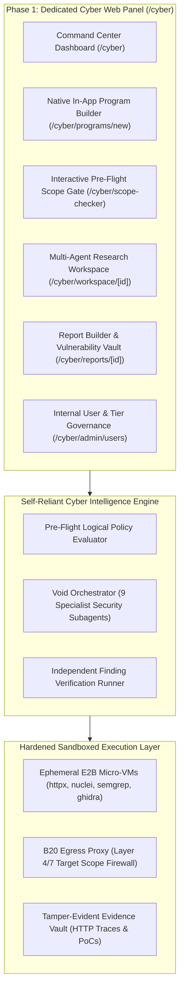

# Void Cyber — Web Platform Specification (Internal-First Build)

> **Strategic Directive**:
> - **Phase 1 (CURRENT BUILD FOCUS)**: Build the full-stack **Void Cyber Web Platform** inside `apps/web`. The platform is designed initially for **internal users, team members, and admins**. It features a native **In-App Program & Scope Builder** allowing teams to define targets, assets, CIDRs, and testing exclusions directly without any external third-party API dependencies (no HackerOne or Bugcrowd API keys required).
> - **Phase 2 (FUTURE PUBLIC EXPANSION)**: Evaluate and integrate the official **HackerOne / Bugcrowd API connectors** and launch self-service public researcher onboarding with automated OSINT background research.

---

## 1. System Architecture Overview



---

## 2. Phase 1 Core Capabilities (Current Web Build)

### 2.1 Internal User & Admin Access
- Access is managed natively inside Void Agent. Admins invite internal team members, assign access tiers (Tier 1: Auditor, Tier 2: Researcher, Tier 3: Admin), and monitor live sessions and audit logs.

### 2.2 Native In-App Program & Scope Builder
- Admins create target programs directly inside the web UI.
- Specify in-scope assets: FQDNs, wildcards (`*.target.com`), IPv4/IPv6 CIDR blocks, mobile APK identifiers, and URL paths.
- Define explicit out-of-scope assets and prohibited vulnerability categories (e.g., DoS, social engineering).
- Zero third-party API dependencies: all scope data is stored in the local PostgreSQL database.

### 2.3 Interactive Pre-Flight Scope Gate
- Before running tools, researchers or agents query the pre-flight gate.
- Evaluates target against program assets and exclusions, returning `Allowed`, `Conditional` (triggers HITL confirmation), or `Disallowed` with policy citations.

### 2.4 Research Workspace (`/cyber/workspace/[id]`)
- 3-pane responsive desktop/web interface:
  1. **Specialist Agent Swarm Console**: Chat with Recon, Web, API, and Code Audit agents.
  2. **Live Tool Terminal & Egress Monitor**: Real-time terminal output from sandboxed CLI tools and live B20 proxy packet logs.
  3. **Scope & Evidence Inspector**: Live target status, active policy rules, and captured evidence traces.

### 2.5 Hardened E2B Sandboxes & B20 Egress Proxy
- Ephemeral micro-VMs run pinned security tools without touching the host application server.
- The B20 egress proxy resolves DNS internally and drops any outbound socket connection outside the target IP allowlist.
- Loopback (`127.0.0.1`), RFC1918 private subnets, and cloud metadata (`169.254.169.254`) are permanently blocked.

### 2.6 Independent Verification Agent
- Automatically spawns a fresh sandbox to reproduce candidate findings independently, verifying whether the PoC reliably demonstrates the vulnerability.

### 2.7 Report Builder & Exporter
- Compiles verified findings into standardized reports with CWE classifications, CVSS 3.1 score vectors, reproduction steps, and remediation advice.
- Direct export to Markdown, structured JSON, and PDF for internal engineering handoff.

---

## 3. Database Schema (`schema.cyber.pg.ts`)

```typescript
import { pgTable, text, timestamp, boolean, integer, jsonb, uuid, varchar, index } from "drizzle-orm/pg-core";
import { users } from "./schema.pg";

// 1. Researcher Profiles (Internal / Admin Governed)
export const cyberResearcherProfiles = pgTable("cyber_researcher_profiles", {
  userId: text("user_id").primaryKey().references(() => users.id, { onDelete: "cascade" }),
  accessTier: integer("access_tier").notNull().default(1), // 1: Auditor, 2: Researcher, 3: Admin
  role: varchar("role", { length: 32 }).notNull().default("researcher"), // admin, researcher, auditor
  status: varchar("status", { length: 32 }).notNull().default("active"),
  voidTrustScore: integer("void_trust_score").notNull().default(500),
  mfaEnforced: boolean("mfa_enforced").notNull().default(false),
  invitedByUserId: text("invited_by_user_id").references(() => users.id),
  createdAt: timestamp("created_at").defaultNow().notNull(),
  updatedAt: timestamp("updated_at").defaultNow().notNull(),
});

// 2. Target Programs (In-App Created)
export const cyberPrograms = pgTable("cyber_programs", {
  id: uuid("id").defaultRandom().primaryKey(),
  name: varchar("name", { length: 255 }).notNull(),
  programHandle: varchar("program_handle", { length: 128 }).notNull().unique(),
  description: text("description"),
  policyMarkdown: text("policy_markdown"),
  hasBounties: boolean("has_bounties").notNull().default(false),
  currency: varchar("currency", { length: 8 }).default("USD"),
  rulesMetadata: jsonb("rules_metadata").notNull().default({}),
  createdByUserId: text("created_by_user_id").notNull().references(() => users.id),
  createdAt: timestamp("created_at").defaultNow().notNull(),
  updatedAt: timestamp("updated_at").defaultNow().notNull(),
});

// 3. Asset Scopes
export const cyberProgramScopes = pgTable("cyber_program_scopes", {
  id: uuid("id").defaultRandom().primaryKey(),
  programId: uuid("program_id").notNull().references(() => cyberPrograms.id, { onDelete: "cascade" }),
  assetIdentifier: text("asset_identifier").notNull(),
  assetType: varchar("asset_type", { length: 32 }).notNull(), // url, domain, wildcard, cidr, mobile_app
  isInScope: boolean("is_in_scope").notNull().default(true),
  maxSeverityAllowed: varchar("max_severity_allowed", { length: 32 }),
  instructionNotes: text("instruction_notes"),
  createdAt: timestamp("created_at").defaultNow().notNull(),
}, (table) => ({
  programAssetIdx: index("cyber_program_asset_idx").on(table.programId, table.assetIdentifier),
}));

// 4. Research Sessions
export const cyberSessions = pgTable("cyber_sessions", {
  id: uuid("id").defaultRandom().primaryKey(),
  userId: text("user_id").notNull().references(() => users.id, { onDelete: "cascade" }),
  programId: uuid("program_id").notNull().references(() => cyberPrograms.id),
  title: varchar("title", { length: 255 }).notNull(),
  status: varchar("status", { length: 32 }).notNull().default("active"),
  sandboxId: varchar("sandbox_id", { length: 128 }),
  sandboxProxyToken: text("sandbox_proxy_token"),
  assignedAgents: jsonb("assigned_agents").notNull().default([]),
  createdAt: timestamp("created_at").defaultNow().notNull(),
  updatedAt: timestamp("updated_at").defaultNow().notNull(),
});

// 5. Findings & Evidence
export const cyberFindings = pgTable("cyber_findings", {
  id: uuid("id").defaultRandom().primaryKey(),
  sessionId: uuid("session_id").notNull().references(() => cyberSessions.id, { onDelete: "cascade" }),
  userId: text("user_id").notNull().references(() => users.id),
  title: varchar("title", { length: 255 }).notNull(),
  cweId: varchar("cwe_id", { length: 32 }),
  cvssScore: varchar("cvss_score", { length: 16 }),
  severity: varchar("severity", { length: 32 }).notNull(),
  affectedAsset: text("affected_asset").notNull(),
  status: varchar("status", { length: 32 }).notNull().default("candidate"),
  reproductionSteps: text("reproduction_steps").notNull(),
  proofOfConcept: text("proof_of_concept").notNull(),
  impactDescription: text("impact_description").notNull(),
  remediationGuidance: text("remediation_guidance"),
  rawToolOutputs: jsonb("raw_tool_outputs").default({}),
  verificationLog: text("verification_log"),
  createdAt: timestamp("created_at").defaultNow().notNull(),
  updatedAt: timestamp("updated_at").defaultNow().notNull(),
});

// 6. Evidence Vault
export const cyberEvidenceVault = pgTable("cyber_evidence_vault", {
  id: uuid("id").defaultRandom().primaryKey(),
  findingId: uuid("finding_id").notNull().references(() => cyberFindings.id, { onDelete: "cascade" }),
  evidenceType: varchar("evidence_type", { length: 32 }).notNull(),
  sha256Hash: varchar("sha256_hash", { length: 64 }).notNull(),
  payloadBytes: text("payload_bytes").notNull(),
  capturedAt: timestamp("captured_at").defaultNow().notNull(),
});

// 7. Structured Reports
export const cyberReports = pgTable("cyber_reports", {
  id: uuid("id").defaultRandom().primaryKey(),
  findingId: uuid("finding_id").notNull().references(() => cyberFindings.id, { onDelete: "cascade" }),
  reportFormat: varchar("report_format", { length: 32 }).notNull().default("markdown"),
  compiledPayload: jsonb("compiled_payload").notNull(),
  qualityScore: integer("quality_score").notNull().default(0),
  qualityFeedback: jsonb("quality_feedback").default([]),
  exportedAt: timestamp("exported_at"),
  createdAt: timestamp("created_at").defaultNow().notNull(),
});

// 8. Audit Events
export const cyberAuditEvents = pgTable("cyber_audit_events", {
  id: uuid("id").defaultRandom().primaryKey(),
  userId: text("user_id").notNull().references(() => users.id, { onDelete: "cascade" }),
  sessionId: uuid("session_id").references(() => cyberSessions.id),
  eventType: varchar("event_type", { length: 64 }).notNull(),
  severity: varchar("severity", { length: 16 }).notNull().default("info"),
  details: jsonb("details").notNull().default({}),
  timestamp: timestamp("timestamp").defaultNow().notNull(),
});
```

---

## 4. Immediate Development Plan (Phase 1 Build Checklist)

1. **Database Layer**: Add `apps/web/src/lib/db/pg/schema.cyber.pg.ts`, create migration script `0081_void_cyber_subsystem.sql`, run `pnpm db:check`.
2. **UI Shell & Navigation**: Add top-level `Cyber` navigation in app header/sidebar, create layout `apps/web/src/app/(app)/cyber/layout.tsx`.
3. **In-App Program Builder**: Build `/cyber/programs` and `/cyber/programs/new` forms with dynamic asset inputs.
4. **Pre-Flight Scope Gate**: Implement asset tree matcher (`apps/web/src/lib/cyber/scope/matcher.ts`) and `/cyber/scope-checker` UI.
5. **Sandboxed Workspace**: Extend B20 egress proxy with target allowlist rules, implement E2B runner, and create `/cyber/workspace/[id]`.
6. **Findings & Reports**: Build Finding Vault, Independent Verification Agent, and Report Exporter (`/cyber/reports/[id]`).
7. **Admin Governance**: Build `/cyber/admin/users` for internal team management and audit log inspection.
