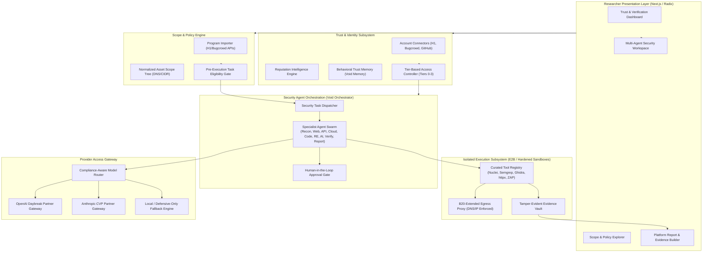
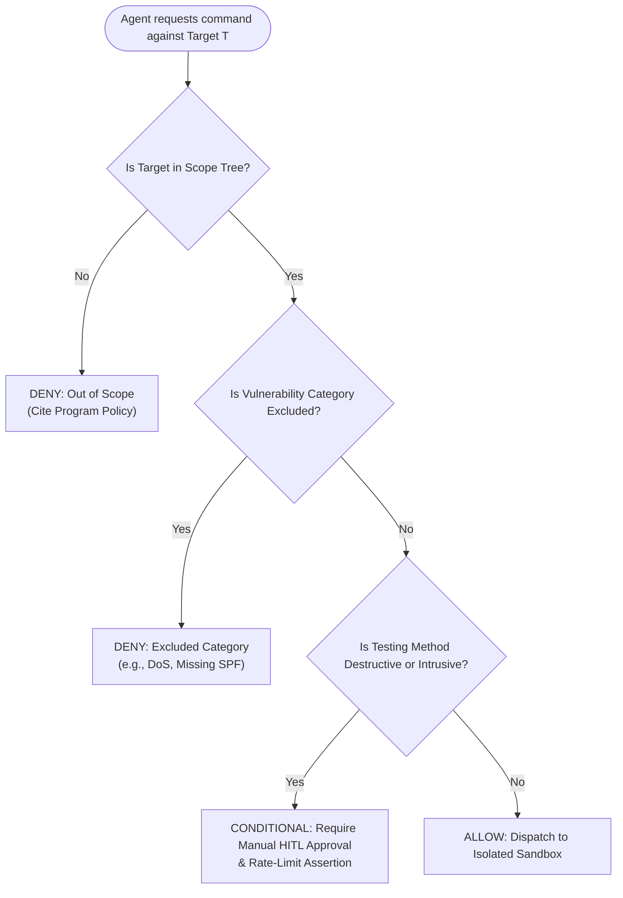
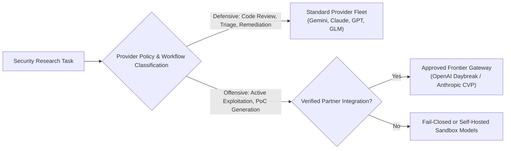
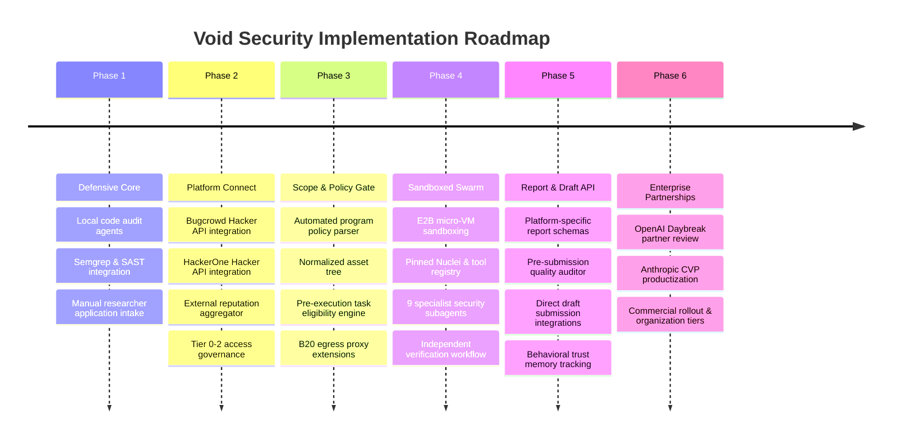

# Void Security — Architecture & Implementation Specification

This document provides the definitive implementation blueprint for **Void Security**, an AI-powered security research and vulnerability discovery workspace built natively inside Void Agent.

---

## 1. System Architecture Overview

Void Security elevates Void Agent from a conversational developer workspace to a specialized, trusted security research environment. The architecture is decomposed into six modular, interconnected layers:



---

## 2. Database Schema (Drizzle ORM / PostgreSQL)

The schema extends Void Agent's existing PostgreSQL and pgvector database foundation (`apps/web/src/lib/db/pg/schema.pg.ts`).

### Schema Definition: `src/lib/db/pg/schema.security.pg.ts`

```typescript
import { pgTable, text, timestamp, boolean, integer, jsonb, uuid, varchar, primaryKey, index } from "drizzle-orm/pg-core";
import { users } from "./schema.pg";

// 1. Researcher Profile & Access Tiers
export const securityResearchers = pgTable("security_researchers", {
  userId: text("user_id").primaryKey().references(() => users.id, { onDelete: "cascade" }),
  accessTier: integer("access_tier").notNull().default(0), // 0: Applicant, 1: Verified, 2: Trusted, 3: Org
  status: varchar("status", { length: 32 }).notNull().default("pending"), // pending, active, suspended, revoked
  voidScore: integer("void_score").notNull().default(0), // 0 - 1000 aggregated reputation score
  idVerificationProvider: varchar("id_verification_provider", { length: 64 }), // stripe_identity, persona, manual
  idVerificationReference: text("id_verification_reference"),
  idVerifiedAt: timestamp("id_verified_at"),
  mfaEnforced: boolean("mfa_enforced").notNull().default(false),
  suspensionReason: text("suspension_reason"),
  createdAt: timestamp("created_at").defaultNow().notNull(),
  updatedAt: timestamp("updated_at").defaultNow().notNull(),
});

// 2. Connected Platform Accounts
export const researcherConnectedAccounts = pgTable("researcher_connected_accounts", {
  id: uuid("id").defaultRandom().primaryKey(),
  userId: text("user_id").notNull().references(() => users.id, { onDelete: "cascade" }),
  platform: varchar("platform", { length: 32 }).notNull(), // hackerone, bugcrowd, github
  platformUsername: varchar("platform_username", { length: 128 }).notNull(),
  platformUserId: varchar("platform_user_id", { length: 128 }),
  encryptedToken: text("encrypted_token").notNull(), // AES-256-GCM encrypted via ENCRYPTION_MASTER_KEY
  tokenExpiresAt: timestamp("token_expires_at"),
  metrics: jsonb("metrics").notNull().default({}), // Platform-specific stats: signal, impact, kudos, rank
  verifiedFindingsCount: integer("verified_findings_count").notNull().default(0),
  lastSyncedAt: timestamp("last_synced_at").defaultNow().notNull(),
  isActive: boolean("is_active").notNull().default(true),
  createdAt: timestamp("created_at").defaultNow().notNull(),
}, (table) => ({
  userPlatformIdx: index("user_platform_idx").on(table.userId, table.platform),
}));

// 3. Bug Bounty Programs & Scope Cache
export const securityPrograms = pgTable("security_programs", {
  id: uuid("id").defaultRandom().primaryKey(),
  platform: varchar("platform", { length: 32 }).notNull(), // hackerone, bugcrowd, private_custom
  platformProgramHandle: varchar("platform_program_handle", { length: 128 }).notNull(),
  name: varchar("name", { length: 255 }).notNull(),
  policyUrl: text("policy_url"),
  policyMarkdown: text("policy_markdown"),
  policyVersionHash: varchar("policy_version_hash", { length: 64 }),
  hasBounties: boolean("has_bounties").notNull().default(true),
  minBountyCents: integer("min_bounty_cents"),
  maxBountyCents: integer("max_bounty_cents"),
  currency: varchar("currency", { length: 8 }).default("USD"),
  safeHarborLevel: varchar("safe_harbor_level", { length: 32 }).default("full"), // full, partial, none
  rulesMetadata: jsonb("rules_metadata").notNull().default({}), // Excluded categories, testing windows, rate limits
  lastSyncedAt: timestamp("last_synced_at").defaultNow().notNull(),
  createdAt: timestamp("created_at").defaultNow().notNull(),
});

// 4. Program Assets (Scope)
export const securityProgramScopes = pgTable("security_program_scopes", {
  id: uuid("id").defaultRandom().primaryKey(),
  programId: uuid("program_id").notNull().references(() => securityPrograms.id, { onDelete: "cascade" }),
  assetIdentifier: text("asset_identifier").notNull(), // *.example.com, 192.168.1.0/24, com.app.android
  assetType: varchar("asset_type", { length: 32 }).notNull(), // url, domain, wildcard, cidr, mobile_app, source_repo
  isInScope: boolean("is_in_scope").notNull().default(true), // true = eligible, false = strictly prohibited
  maxSeverityAllowed: varchar("max_severity_allowed", { length: 32 }), // e.g., low, high, critical
  instructionNotes: text("instruction_notes"),
  createdAt: timestamp("created_at").defaultNow().notNull(),
}, (table) => ({
  programAssetIdx: index("program_asset_idx").on(table.programId, table.assetIdentifier),
}));

// 5. Research Workspaces / Sessions
export const securityResearchSessions = pgTable("security_research_sessions", {
  id: uuid("id").defaultRandom().primaryKey(),
  userId: text("user_id").notNull().references(() => users.id, { onDelete: "cascade" }),
  programId: uuid("program_id").notNull().references(() => securityPrograms.id),
  title: varchar("title", { length: 255 }).notNull(),
  status: varchar("status", { length: 32 }).notNull().default("active"), // active, paused, completed, archived
  sandboxId: varchar("sandbox_id", { length: 128 }), // Bound E2B sandbox instance
  sandboxProxyToken: text("sandbox_proxy_token"), // Ephemeral JWT for egress proxy validation
  assignedAgents: jsonb("assigned_agents").notNull().default([]),
  contextMemorySnapshot: text("context_memory_snapshot"),
  createdAt: timestamp("created_at").defaultNow().notNull(),
  updatedAt: timestamp("updated_at").defaultNow().notNull(),
});

// 6. Security Findings & Evidence Vault
export const securityFindings = pgTable("security_findings", {
  id: uuid("id").defaultRandom().primaryKey(),
  sessionId: uuid("session_id").notNull().references(() => securityResearchSessions.id, { onDelete: "cascade" }),
  userId: text("user_id").notNull().references(() => users.id),
  title: varchar("title", { length: 255 }).notNull(),
  cweId: varchar("cwe_id", { length: 32 }), // e.g. CWE-89, CWE-287
  cvssScore: varchar("cvss_score", { length: 16 }),
  severity: varchar("severity", { length: 32 }).notNull(), // info, low, medium, high, critical
  affectedAsset: text("affected_asset").notNull(),
  status: varchar("status", { length: 32 }).notNull().default("candidate"), // candidate, verified, rejected, reported
  reproductionSteps: text("reproduction_steps").notNull(),
  proofOfConcept: text("proof_of_concept").notNull(),
  impactDescription: text("impact_description").notNull(),
  remediationGuidance: text("remediation_guidance"),
  rawToolOutputs: jsonb("raw_tool_outputs").default({}),
  verificationLog: text("verification_log"), // Output from Verification Agent
  createdAt: timestamp("created_at").defaultNow().notNull(),
  updatedAt: timestamp("updated_at").defaultNow().notNull(),
});

// 7. Structured Report Artifacts
export const securityReports = pgTable("security_reports", {
  id: uuid("id").defaultRandom().primaryKey(),
  findingId: uuid("finding_id").notNull().references(() => securityFindings.id, { onDelete: "cascade" }),
  targetPlatform: varchar("target_platform", { length: 32 }).notNull(), // hackerone, bugcrowd, markdown_custom
  platformPayload: jsonb("platform_payload").notNull(), // Formatted JSON matching platform API schema
  qualityScore: integer("quality_score").notNull().default(0), // 0-100 pre-submission quality audit
  qualityFeedback: jsonb("quality_feedback").default([]), // Missing items, reproducibility warnings
  draftExportedAt: timestamp("draft_exported_at"),
  platformSubmissionId: varchar("platform_submission_id", { length: 128 }),
  createdAt: timestamp("created_at").defaultNow().notNull(),
});

// 8. Behavioral Audit Events (Trust & Memory Tracking)
export const securityBehaviorEvents = pgTable("security_behavior_events", {
  id: uuid("id").defaultRandom().primaryKey(),
  userId: text("user_id").notNull().references(() => users.id, { onDelete: "cascade" }),
  sessionId: uuid("session_id").references(() => securityResearchSessions.id),
  eventType: varchar("event_type", { length: 64 }).notNull(), // scope_check, scope_breach_prevented, unverified_claim_flagged, rate_limit_hit, destructive_tool_prevented
  severity: varchar("severity", { length: 16 }).notNull().default("info"), // info, warning, breach
  details: jsonb("details").notNull().default({}),
  timestamp: timestamp("timestamp").defaultNow().notNull(),
});
```

---

## 3. Subsystem Implementation Specifications

### 3.1 Researcher Trust & Reputation Engine

#### Reputation Score Calculation
The engine evaluates six weighted vectors to derive a composite score ($0 - 1000$ points) determining researcher access tier:

$$\text{VoidScore} = (W_{\text{valid}} \cdot S_{\text{valid}}) + (W_{\text{sev}} \cdot S_{\text{sev}}) + (W_{\text{acc}} \cdot S_{\text{acc}}) + (W_{\text{rec}} \cdot S_{\text{rec}}) + (W_{\text{rep}} \cdot S_{\text{rep}}) + (W_{\text{code}} \cdot S_{\text{code}})$$

*Weights Matrix:*
- **Verified Valid Reports ($W_{\text{valid}} = 0.25$)**: Ratio of triaged/accepted submissions across HackerOne/Bugcrowd.
- **Demonstrated Severity & Impact ($W_{\text{sev}} = 0.20$)**: Weighting favoring High/Critical findings over volume of Low findings.
- **Report Accuracy & Signal ($W_{\text{acc}} = 0.20$)**: Signal-to-noise ratio; penalizes spam, invalid, or duplicate reports.
- **Recent Research Activity ($W_{\text{rec}} = 0.15$)**: Verified disclosure activity within the last 180 days.
- **Platform Standing & Kudos ($W_{\text{rep}} = 0.10$)**: Normalized Bugcrowd Kudos percentile and HackerOne reputation rank.
- **Open-Source & Security Contributions ($W_{\text{code}} = 0.10$)**: Verified GitHub contributions to security tools, research whitepapers, or recognized CVE credits.

#### Behavioral Trust Memory (Void Memory Integration)
In addition to external reputation, the system records operational observations into persistent Markdown memory profiles under `<userDataDir>/security/researcher/<userId>/`:
- `PROFILE.md`: Base identity, verified platforms, current tier.
- `BEHAVIOUR.md`: Historical compliance record (e.g., stops immediately on out-of-scope targets, respects rate limits, provides complete reproduction steps).
- `TRUST_ASSESSMENT.md`: Automated, timestamped evaluations synthesizing behavioral events and score adjustments.

#### Connection Lifecycle & Access Suspension
- If a connected platform token expires, is revoked, or returns HTTP 401/403:
  1. The researcher's active privileged sessions are transitioned to `paused`.
  2. Advanced offensive execution tools are immediately locked.
  3. The researcher is prompted to re-authenticate without deleting their historical audit records.
  4. Access is suspended gracefully—not converted to an unappealable permanent ban unless deliberate fraud or malicious activity is detected.

---

### 3.2 Target Scope & Pre-Flight Policy Gate

#### Ingestion of Platform APIs
- **Bugcrowd Hacker API**:
  - Endpoint: `GET /hackers/programs` and `GET /hackers/programs/{code}`
  - Synchronizes target scopes, testing restrictions, reward ranges, and safe harbor declarations.
- **HackerOne Hacker API**:
  - Endpoint: `GET /v1/hackers/programs`
  - Retrieves structured assets, excluded categories, and policy markdown.

#### Scope Normalization Tree
Assets are parsed into a deterministic lookup tree:
- **Wildcards / FQDNs**: `*.sub.example.com` $\to$ domain suffix tree match.
- **IP Networks**: Stored as native PostgreSQL CIDR blocks with bitmask evaluation.
- **Mobile Assets**: Bundle IDs (`com.vendor.app`) and SHA-256 binary signatures.

#### Pre-Execution Evaluation Algorithm
Before any specialist agent or CLI tool executes against a target $T$:



Four possible state outputs:
1. **Allowed**: Fully compliant with current published scope and method rules.
2. **Conditional**: Requires explicit Human-in-the-Loop approval (e.g., rate-intensive scanning, authenticated state alterations).
3. **Disallowed**: Strictly forbidden by policy (e.g., DoS testing, out-of-scope domain, physical access vector).
4. **Unknown**: Insufficient policy data; agent blocks execution and advises consulting the program owner.

---

### 3.3 Sandboxed Execution & Network Egress Boundaries

#### Hardened Execution Environment
All security tooling runs inside isolated ephemeral sandboxes (E2B / micro-VM containers). The app server never executes security tools directly.

#### B20 Egress Proxy Enforcement
Building upon Void Agent's existing B20 egress boundary architecture:
- Every sandbox outbound socket is routed through an authenticated forward egress proxy (`security-egress-proxy`).
- **IP Pinning & DNS Validation**: DNS queries are resolved on the proxy; direct socket connections to unpinned IPs or dynamic rebinding targets are aborted.
- **Scope Restriction**: If an agent attempts to transmit an HTTP request or probe a host outside the authorized target CIDR/domain set, the proxy drops the packet at Layer 4/Layer 7 and registers a `scope_breach_prevented` audit event.
- **Anti-SSRF Protection**: Sockets destined for loopback (`127.0.0.0/8`), RFC1918 private subnets (`10.0.0.0/8`, `172.16.0.0/12`, `192.168.0.0/16`), link-local addresses (`169.254.0.0/16`), or cloud metadata endpoints (`169.254.169.254`) are unconditionally blocked at the network interface level.

#### Curated Tool Catalog
| Tool | Version / Standard | Operational Constraints |
| :--- | :--- | :--- |
| **Nuclei** | Pinned release; curated template submodule | Community templates undergo static impact analysis. High/Critical or intrusive templates require Tier 2+ and explicit HITL approval. |
| **httpx** | Pinned release | Hard rate-limiting flags enforced by default (`-rl 20`, `-t 10`). |
| **OWASP ZAP** | Headless daemon via automation framework | Passive scanning allowed by default; active attack mode requires in-scope confirmation and conditional clearance. |
| **Semgrep** | Latest stable release | Local static analysis within the sandbox; zero external network egress. |
| **Ghidra** | Headless script runner | Read-only analysis inside non-networked VM instance. |

---

### 3.4 Specialist Agent Swarm

Instead of a monolithic "pentest bot", Void Security uses 9 specialized subagents coordinated by the Void Orchestrator:

```
┌──────────────────────────────────────────────────────────────┐
│                    Void Security Orchestrator                │
└──────────────────────────────┬───────────────────────────────┘
                               │
       ┌───────────────────────┼───────────────────────┐
       ▼                       ▼                       ▼
┌──────────────┐        ┌──────────────┐        ┌──────────────┐
│  Recon Agent │        │  Web Agent   │        │  API Agent   │
└──────┬───────┘        └──────┬───────┘        └──────┬───────┘
       │                       │                       │
       └───────────────────────┼───────────────────────┘
                               │ (Findings Stream)
                               ▼
┌──────────────────────────────────────────────────────────────┐
│                 Independent Verification Agent               │
└──────────────────────────────┬───────────────────────────────┘
                               │ (Reproduced & Proven Findings)
                               ▼
┌──────────────────────────────────────────────────────────────┐
│                   Platform Report Agent                      │
│             (HackerOne / Bugcrowd Draft API)                 │
└──────────────────────────────────────────────────────────────┘
```

1. **Reconnaissance Agent**: Handles DNS enumeration, service probing, and live asset validation using `httpx` within defined scope limits.
2. **Web Security Agent**: Analyzes OWASP Top 10 vulnerabilities (XSS, CSRF, SSRF, broken access controls).
3. **API Security Agent**: Audits REST, GraphQL, and RPC endpoints for IDOR, BOLA, rate-limit lapses, and authentication bypasses.
4. **Cloud Security Agent**: Inspects IAM roles, Cloudflare configurations, and storage bucket permissions.
5. **Code Audit Agent**: Executes SAST workflows using Semgrep to detect insecure deserialization, SQL injection, and cryptographic weaknesses.
6. **Reverse Engineering Agent**: Analyzes provided binaries or APKs in a disconnected container to understand proprietary protocols or hidden endpoints.
7. **AI & Model Security Agent**: Conducts authorized testing of target LLM endpoints for prompt injection, system prompt leakage, and insecure tool invocation.
8. **Independent Verification Agent**: Takes suspected findings from other agents, runs an isolated reproduction run in a fresh context, and validates that the proof-of-concept reproduces reliably.
9. **Platform Report Agent**: Formats validated findings into native HackerOne or Bugcrowd submission specifications, calculates CVSS 3.1 vectors, and flags missing remediation steps.

---

### 3.5 Platform-Native Report Builder & Draft API Integration

#### Structure Normalization
The Report Agent outputs structures customized for the target platform:

##### HackerOne Target Schema
- Title: `[Vulnerability Type] in [Asset] leads to [Impact]`
- Weakness: CWE identifier mapping
- Severity Rating: CVSS v3.1 calculator string
- Structured Sections: Summary, Technical Details, Steps to Reproduce (numbered with curl/script PoC), Impact, Remediation Advice, Attachments/Evidence

##### Bugcrowd Target Schema
- Title
- Target Asset: Selected from program asset dropdown
- Vulnerability Type: VRT (Vulnerability Rating Taxonomy) mapping
- Proof of Concept / Reproduction URL
- Severity: Priority rating (P1 to P5)
- Description & Remediation

#### Pre-Submission Quality Engine
Every draft report is audited before export:
- Checks that reproduction steps contain concrete inputs, endpoints, and observed vs. expected outputs.
- Flags ambiguous or exaggerated impact statements (e.g., claiming "full RCE" when only blind SSRF is verified).
- Scans for inadvertent leakage of credentials, third-party user PII, or internal keys in HTTP logs.

#### API Draft Integration
- **Bugcrowd**: Uses the Hacker API draft endpoint (`POST /hackers/programs/{code}/submissions`) with draft status, allowing the researcher to review and submit via the native platform UI.
- **HackerOne**: Integrates via authenticated researcher report endpoints where enabled, or generates ready-to-paste platform markdown with verified image attachments.

---

### 3.6 Provider Access Gateway & Policy Compliance

Void Security prevents unauthorized or policy-violating usage of upstream LLMs:



1. **Defensive Isolation**: Static code analysis, vulnerability remediation, and documentation reviews are permitted across standard provider models.
2. **Offensive Capability Gating**: Active exploit reproduction and intrusive payload generation are strictly gated. If Void Agent does not hold an active enterprise partner agreement with an upstream provider for downstream researcher pass-through, the system fails closed rather than proxying raw attack instructions through consumer API keys.
3. **No Provider Bypass**: The system never routes blocked offensive instructions through unapproved providers or prompts to circumvent safety guardrails.

---

## 4. API Endpoints Specification

| Method | Endpoint | Description | Auth / Role |
| :--- | :--- | :--- | :--- |
| `GET` | `/api/security/researcher/profile` | Returns researcher tier, score, connected accounts, and status. | Authenticated User |
| `POST` | `/api/security/researcher/connect` | Connects HackerOne or Bugcrowd account with encrypted token storage. | Authenticated User |
| `DELETE` | `/api/security/researcher/disconnect` | Disconnects account; suspends elevated tier until re-linked. | Authenticated User |
| `GET` | `/api/security/programs` | Lists available programs with cached scope status and bounties. | Verified Researcher (Tier 1+) |
| `POST` | `/api/security/programs/sync` | Triggers a fresh synchronization of program scope via platform API. | Verified Researcher (Tier 1+) |
| `POST` | `/api/security/tasks/preflight` | Evaluates proposed task against program scope (`allowed`, `conditional`, `disallowed`). | Verified Researcher (Tier 1+) |
| `POST` | `/api/security/sessions` | Initializes a new research workspace session with dedicated sandbox. | Verified Researcher (Tier 1+) |
| `POST` | `/api/security/sessions/[id]/command` | Dispatches an agent or tool command into the sandbox via egress proxy. | Trusted Researcher (Tier 2+) |
| `POST` | `/api/security/findings` | Records a candidate finding with attached evidence artifacts. | Session Member |
| `POST` | `/api/security/findings/[id]/verify` | Triggers the Independent Verification Agent to reproduce the finding. | Session Member |
| `POST` | `/api/security/reports/generate` | Compiles platform-compliant report (H1 / Bugcrowd) and runs quality audit. | Session Member |
| `POST` | `/api/security/reports/[id]/export-draft` | Exports validated draft to HackerOne/Bugcrowd via Hacker API. | Trusted Researcher (Tier 2+) |

---

## 5. UI / UX Experience & Interface Flow

```
+----------------------------------------------------------------------------------------------------+
|  VOID AGENT  |  Chat  |  Projects  |  Workflows  |  [VOID SECURITY]  |              User (Tier 2)   |
+----------------------------------------------------------------------------------------------------+
|                                                                                                    |
|  RESEARCHER COMMAND CENTER                                                                         |
|  +--------------------------------+  +--------------------------------+  +----------------------+  |
|  | Verified Accounts              |  | Trust & Compliance Score       |  | Active Target        |  |
|  | - HackerOne: @researcher (99%) |  | - VoidScore: 842 / 1000        |  | - Program: Acme Corp |  |
|  | - Bugcrowd: @researcher (P1)   |  | - Scope Compliance: 100%       |  | - Scope: 14 Assets   |  |
|  +--------------------------------+  +--------------------------------+  +----------------------+  |
|                                                                                                    |
|  +-------------------------------------------------------------+  +------------------------------+  |
|  | RESEARCH WORKSPACE (Session #VSR-1042)                      |  | SCOPE & ELIGIBILITY INSPECT  |  |
|  |                                                             |  |                              |  |
|  | [Agent Swarm: Web + API + Verification]                     |  | Target: api.acme.com/v1/auth |  |
|  |                                                             |  | Status: [ALLOWED]            |  |
|  | Web Agent: Analyzing token exchange endpoint...            |  | Policy: Sec 3.2 (Auth Scope) |  |
|  | Found: IDOR on /api/v1/user/1042/profile                     |  |                              |  |
|  | Verification Agent: Spun up isolated test context.           |  | REPRODUCTION EVIDENCE        |  |
|  | Reproduction: CONFIRMED (HTTP 200 with victim metadata)     |  | - Raw HTTP Req/Res Pair      |  |
|  |                                                             |  | - Evidence Hash: sha256:7f.. |  |
|  | [Terminal View: httpx / nuclei / egress logs]               |  | - PoC script: exploit.py     |  |
|  +-------------------------------------------------------------+  +------------------------------+  |
|                                                                                                    |
|  +-----------------------------------------------------------------------------------------------+  |
|  | REPORT BUILDER & DRAFT EXPORT                                                                 |  |
|  | Format: [HackerOne Markdown v2] | Quality Score: 96/100                                       |  |
|  | Title: BOLA / IDOR in /api/v1/user/{id} leads to unauthorized user profile disclosure         |  |
|  | [Preview Full Report]  [Run Remediation Validator]  [Export Draft to HackerOne API]           |  |
|  +-----------------------------------------------------------------------------------------------+  |
+----------------------------------------------------------------------------------------------------+
```

---

## 6. Phased Implementation Roadmap



### Phase Details

#### Phase 1: Defensive Core & Local Audit Workspace (Weeks 1–4)
- Implement `securityResearchers` schema and access tier foundation.
- Build Code Audit Agent with sandboxed Semgrep execution for local repositories.
- Internal Void Agent bug bounty intake redesign using new finding and report schemas.

#### Phase 2: Platform Connect & Reputation Engine (Weeks 5–8)
- Implement `researcherConnectedAccounts` with AES-256-GCM token encryption.
- Ingest Bugcrowd and HackerOne researcher profile metrics via authorized APIs.
- Calculate VoidScore and establish Tier 0–2 qualification workflow.

#### Phase 3: Scope Intelligence & Pre-Flight Gate (Weeks 9–12)
- Build automated program scope synchronizer for HackerOne and Bugcrowd.
- Implement asset tree matching and the Pre-Execution Task Eligibility Gate.
- Harden the B20 egress proxy to drop non-in-scope traffic deterministically.

#### Phase 4: Specialist Agent Swarm & Sandboxing (Weeks 13–16)
- Deploy ephemeral E2B sandbox infrastructure with pinned Nuclei, httpx, and ZAP.
- Integrate the 9 specialist subagents with the Void Orchestrator.
- Implement the Independent Verification Agent to reproduce findings safely.

#### Phase 5: Report Builder & Direct Draft API Export (Weeks 17–20)
- Build platform-specific report formatters and pre-submission quality audits.
- Implement draft submission via Bugcrowd and HackerOne APIs.
- Deploy Behavioral Trust Memory tracking under `researcher/` in Void Memory.

#### Phase 6: Provider Partnerships & Production Rollout (Weeks 21+)
- Formalize Daybreak / CVP partner applications with OpenAI and Anthropic.
- Enable Tier 3 (Organization / Red Team) access controls.
- Launch public beta for vetted researcher community.

---

## 7. Legal, Compliance, and Abuse Prevention

1. **Explicit Authorization Pre-Check**: Testing is allowed only against programs where the researcher is verified to participate (public programs or confirmed private invitations).
2. **Clear Boundaries on Payment**: Void Security makes zero guarantees of bug acceptance, duplicate avoidance, or bounty payout; users must explicitly acknowledge that final triage and rewards remain under the sole discretion of the program owner.
3. **Audit Trail Immutability**: All tool executions, egress network destinations, and prompt streams are cryptographically hash-chained and stored for a minimum of 365 days to ensure non-repudiation in the event of an investigation.
4. **Immediate Misuse Action**: Any attempt to bypass the scope gate, exploit unlisted assets, or attack unauthorized infrastructure results in immediate revocation of all tiers and permanent account termination.
