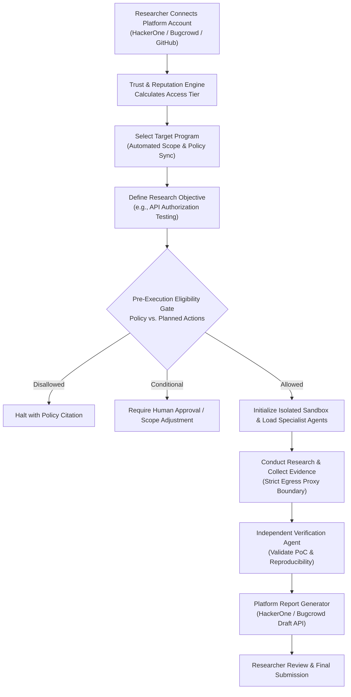

# Void Security

Void Security is an AI-powered security research and vulnerability discovery workspace built directly into Void Agent. Designed specifically for verified security researchers, ethical hackers, and bug bounty hunters, Void Security bridges researcher reputation, program scope governance, autonomous AI agents, isolated sandboxed execution, and platform-native reporting into a unified research environment.

---

## 1. Executive Summary

Traditional AI coding assistants either reject security-related prompts outright or lack the context, isolation, and specialized tooling needed for legitimate research. Conversely, frontier cybersecurity access programs (such as OpenAI Daybreak or Anthropic CVP) have stringent eligibility barriers and do not provide an end-to-end bug bounty workspace.

**Void Security** solves this by establishing a **Trusted Access & Research Ecosystem**:
1. **Researcher Verification & Multi-Source Reputation**: Connects official platform profiles (HackerOne, Bugcrowd, GitHub, CVE disclosures) to determine researcher credibility and access tiers.
2. **Behavioral Trust Intelligence**: Uses Void Agent's memory subsystem to observe in-platform research hygiene, scope compliance, and report accuracy over time.
3. **Program Scope & Policy Intelligence**: Synchronizes target scopes, testing restrictions, and excluded vulnerability categories directly from bug bounty platforms via official APIs.
4. **Pre-Execution Task Eligibility Gate**: Automatically cross-references a researcher's planned activity against target policies before execution, preventing accidental scope violations.
5. **Specialist Security Agent Swarm**: Orchestrates purpose-built autonomous agents (Recon, Web, API, Cloud, Code Audit, Reverse Engineering, AI Security, Verification, Report).
6. **Isolated Sandboxed Execution**: Runs security tools (pinned Nuclei, httpx, OWASP ZAP, Semgrep, Ghidra) in hardened E2B/container environments with network-level egress boundary enforcement.
7. **Platform-Native Reporting & Draft Submissions**: Generates reports structured specifically for HackerOne or Bugcrowd, validates proof-of-concept reproducibility, and exports draft submissions directly via platform APIs.
8. **Provider Access Gateway**: Manages multi-model AI routing to ensure all cyber tasks strictly adhere to upstream LLM provider policies and partnership agreements.

---

## 2. Core Capabilities

| Capability | Description |
| :--- | :--- |
| **Researcher Connect** | OAuth and API key integration with HackerOne and Bugcrowd, aggregating verified statistics, Signal, Kudos, and validated disclosure track records. |
| **Trust Tiers** | Tier 0 (Applicant) through Tier 3 (Organization / Red Team), granting graduated access to defensive tools, active scanning, and specialized models. |
| **Scope Manager** | Automated ingestion and tree-based normalization of program assets (domains, subdomains, CIDR ranges, mobile apps) with real-time policy change monitoring. |
| **Pre-Flight Task Gate** | Evaluates proposed tasks into `Allowed`, `Conditional`, `Disallowed`, or `Unknown` states, backed by exact program policy citations. |
| **Specialist Agents** | 9 distinct security subagents handling discrete phases of assessment, from initial attack-surface recon to independent finding verification. |
| **Tool Registry** | Pinned, curated versions of CLI and SAST tools (Nuclei, Semgrep, httpx, ZAP, Ghidra) with strict flags against unvetted community templates. |
| **Evidence Vault** | Tamper-evident storage of HTTP request/response pairs, terminal logs, screenshots, and reproducible PoCs tied to individual findings. |
| **Report Builder** | Generates platform-compliant Markdown and JSON submissions, scoring draft quality and highlighting missing reproduction steps. |

---

## 3. High-Level Workflow

---

## 4. Researcher Access Tiers

| Tier | Level Name | Verification Requirements | Capabilities & Permissions |
| :--- | :--- | :--- | :--- |
| **Tier 0** | **Applicant** | Email verification, application profile, portfolio links | Read-only security knowledge base, sample reports, no active execution. |
| **Tier 1** | **Verified Researcher** | Verified identity (ID/Persona) OR linked HackerOne/Bugcrowd account with valid submission history; MFA enabled | Defensive security analysis, SAST/code review, passive recon, private repository audits. |
| **Tier 2** | **Trusted Researcher** | Established platform track record (Signal/Kudos thresholds), verified public CVEs, or high report acceptance rate | Active API testing, template-pinned Nuclei scanning against authorized scopes, high sandbox limits. |
| **Tier 3** | **Organization / Red Team** | Corporate verification, dedicated security contacts, verified written testing authorization & scope agreement | Full multi-agent orchestration, advanced binary/reverse engineering, elevated concurrency, custom tool plugins. |

---

## 5. Security & Safety Boundaries

1. **Deterministic Scope Enforcement**: Scope boundaries are enforced at the network proxy and container virtualization layer (DNS pinning, egress firewalls, IP CIDR filtering), not solely by LLM prompt instructions.
2. **Fail-Closed Provider Gateway**: Tasks requiring active exploit analysis are routed only to LLM providers who have explicitly authorized downstream security research partnerships.
3. **No Bounty Guarantees**: Void Security explicitly does not guarantee vulnerability acceptance, bounty payment, or novelty; all payouts and triage decisions rest solely with target program owners.
4. **Immediate Privilege Suspension**: Disconnecting or revoking a linked platform account immediately suspends privileged research capabilities until re-verified.
5. **Auditable Artifact Trail**: Every tool execution, HTTP request, model decision, and terminal command is immutably logged for auditability and compliance.

---

## 6. Implementation Architecture

For the complete technical blueprint, database schema, API contracts, sandboxing architecture, and multi-agent coordination protocols, refer to:
- [Void Security Implementation Specification](file:///C:/Users/Ibrahim/Desktop/Void-Agent/docs/features/void-security-implementation.md)
